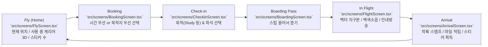

# Carry On — Corpus Map & Codebase Index

> **AI Agent Quick Directive**:
> This document is the single source of truth for repository structure, module responsibilities, symbol exports, and domain logic.
> **Before reading multiple source files, consult this map** to identify the exact 1–2 target files needed. Do NOT read entire directories into context.

---

## 1. Quick Intent Router (기능별 직행 색인)

AI 에이전트가 특정 작업 요청을 받았을 때 바로 찾아갈 파일 매핑입니다.

| 작업 목적 (Task Intent) | 핵심 파일 (Primary Files) | 연관 컴포넌트/스타일 | 테스트 파일 |
|---|---|---|---|
| **비행 시간 / 거리 계산 공식** | `src/domain/geo.ts` | `src/domain/booking.ts` | `src/domain/geo.test.ts` |
| **목적지 / 소요시간 기반 예약** | `src/domain/booking.ts`, `src/screens/BookingScreen.tsx` | `src/screens/BookingScreen.module.css`, `src/data/cities.ts` | `src/domain/booking.test.ts` |
| **비행계획 / 편명 / 게이트 생성** | `src/domain/flightPlan.ts` | `src/data/airlines.ts`, `src/domain/random.ts` | `src/domain/flight.test.ts` |
| **좌석 배치도 / 기종별 캐빈 / 자동 배정** | `src/domain/seatmap.ts` | `src/components/SeatMapView.tsx`, `src/components/SeatMapView.module.css` | `src/domain/flight.test.ts` |
| **기내 엔진 백색소음 / 합성 사운드** | `src/audio/cabinAudio.ts` | `src/audio/announcer.ts`, `src/audio/tearSound.ts` | — |
| **탑승권 스텁 뜯기 / 찢는 소리** | `src/components/BoardingPass.tsx`, `src/audio/tearSound.ts` | `src/components/BoardingPass.module.css`, `src/screens/BoardingScreen.tsx` | — |
| **기내 안내방송 텍스트 & 클립 재생** | `src/domain/announcements.ts` (확정 대본, 구절 단위), `src/domain/voiceClips.ts` (목소리·클립 이름·전체 구절), `src/audio/announcer.ts`, `src/audio/pa.ts` | `src/screens/FlightScreen.tsx` (방송 타이밍: 이륙·순항·하강·착륙·난기류), `src/screens/ArrivalScreen.tsx` | `src/domain/announcements.test.ts`, `src/domain/voiceClips.test.ts` |
| **기내 소음 기종 음색 (실제 녹음 → 필터)** | `scripts/sound/make_cabin_ir.py`, `src/domain/cabinTimbre.ts` | `public/audio/cabin/*.wav` (음색 필터), `src/audio/cabinAudio.ts` (`recordedCabin()`) | `src/domain/cabinTimbre.test.ts` |
| **안내방송 음성 생성 (Kokoro·Chatterbox, 오프라인)** | `scripts/tts/generate_clips.py` (앱용 전체 클립), `scripts/tts/list_parts.mjs` → `scripts/tts/parts.json`, `scripts/tts/generate_samples.py`·`chatterbox_samples.py` (후보 비교) | `public/audio/voice/<목소리>/*.mp3`, `public/voice-samples/index.html` (사운드 랩: 목소리 후보 + PA 필터 + 완성 방송 미리듣기), 데스크톱 안내 `docs/VOICE_CLIPS.md` | — |
| **비행 모니터 상태 (고도/속도/페이즈)** | `src/domain/flightProfile.ts` | `src/screens/FlightScreen.tsx`, `src/screens/FlightScreen.module.css` | `src/domain/flight.test.ts` |
| **지구본 지도 / 낮밤 음영 / 태양 위치** | `src/map/FlightMap.tsx`, `src/domain/sun.ts` | `src/map/FlightMap.module.css`, `src/map/worldData.ts` | `src/domain/sky.test.ts` |
| **착륙 처리 / 마일리지 / 스티커 발급** | `src/domain/landing.ts`, `src/db/db.ts` | `src/screens/ArrivalScreen.tsx`, `src/screens/ArrivalScreen.module.css` | `src/domain/flight.test.ts` |
| **수하물 태그 및 스티커 디자인** | `src/components/BagTag.tsx` | `src/components/BagTag.module.css`, `src/components/Barcode.tsx` | — |
| **회원 등급 (Tier) 및 마일리지 보너스** | `src/domain/tier.ts` | `src/store/useTier.ts`, `src/components/TierBadge.tsx` | `src/domain/tier.test.ts` |
| **로컬 DB 스키마 / IndexedDB 함수** | `src/db/db.ts` | `src/store/appStore.ts` | — |
| **도시 및 공항 데이터 (IATA/좌표/시차)** | `src/data/cities.ts` | `src/domain/types.ts` | — |
| **캐리어 30종 카탈로그 / 면세점 / 보관함 3D / 스티커 자리·데칼 / 채우기 보상** | `src/data/carriers.ts`, `src/data/carrierSlots.json`, `src/domain/carrierShop.ts`, `src/domain/stickerArt.ts`, `src/db/db.ts` | `src/screens/LuggageScreen.tsx`, `src/screens/DutyFreeScreen.tsx`, `src/screens/ArrivalScreen.tsx`, `src/components/Carrier3D.tsx`, `src/components/stickerDecals.ts`, `src/components/CarrierThumb.tsx`, `src/components/carrierBake.ts`, `vite.config.ts`, `scripts/models/optimize-carriers.mjs` | `src/domain/carrierShop.test.ts`, `src/domain/stickerArt.test.ts` |
| **가상 항공사 데이터 (코드/이름/리버리색)** | `src/data/airlines.ts` | `src/components/BagTag.tsx`, `src/domain/flightPlan.ts` | — |
| **화면 전환 / 내비게이션 / 드래프트 상태** | `src/store/appStore.ts`, `src/App.tsx` | `src/App.module.css`, `src/components/TabBar.tsx` | — |
| **여권 (책자 넘김·데이터 면·MRZ·사진·이름·국적)** | `src/screens/PassportScreen.tsx`, `src/domain/passport.ts` | `src/components/PassportPages.tsx`, `src/components/PassportEditor.tsx`, `src/audio/passportSound.ts` | `src/domain/passport.test.ts` |
| **나라별 출입국 도장 (모양·잉크·문구)** | `src/data/countries.ts`, `src/components/PassportStamp.tsx` | `src/domain/passport.ts` (`stampsFor()`, `visaPages()`) | `src/domain/passport.test.ts` |
| **볼륨 / 맵스타일 / 오디오 설정 (로컬저장)** | `src/store/settings.ts` | `src/screens/FlightScreen.tsx` | — |
| **글로벌 테마 / 폰트 / 다크모드 (라이트·다크·자동)** | `src/styles/global.css`, `src/theme.ts` | `src/App.module.css`, `src/components/ThemeMenu.tsx`, `src/store/settings.ts`, `src/main.tsx` | — |
| **개발 모드 플래그 (?tier=, ?speed=, ?bake-carriers)** | `src/dev.ts` | `src/store/useTier.ts`, `src/screens/FlightScreen.tsx`, `src/main.tsx`, `src/components/carrierBake.ts` | — |

---

## 2. Core Architecture & Lifecycle Flow

Carry On은 집중 타이머(Pomodoro 대안)를 항공기 여정 경험으로 치환한 웹/모바일 앱입니다.
로컬 퍼스트(Dexie IndexedDB)로 동작하며, 화면 흐름은 Flighty-style 단선형 여행 단계를 따릅니다.



### 상태 데이터 흐름
1. **Fly**: `db.profile` & `db.carriers` & `db.stickers` 조회 → 홈 화면 렌더.
2. **Booking**: 사용자가 목적지 또는 시간을 선택 → `planRoute()` or `planScenic()` 호출 → `useApp.setDraft({ plan, purpose: 'study' })`.
3. **Checkin**: 좌석 선택 (`buildSeatMap()`, `autoAssign()`) 및 목적(purpose) 확정 → `draft.seat` 저장.
4. **Boarding**: 탑승권 스텁 드래그 완료 시 `startFlight()` 실행 → IndexedDB에 `Flight` 저장 (`status: 'in_flight'`) → `cabinAudio.start()` 엔진 사운드 시작.
5. **Flight**: 실시간 타이머 및 진행률 계산 → 고도/속도 프로파일 갱신 → 도착 시 `landFlight()` 실행 (또는 포기 시 `divertFlight()`).
6. **Arrival**: 마일리지 가산, 스티커 생성 및 캐리어에 부착 완료 후 다시 `Fly` 화면으로 복귀.

---

## 3. Directory & File Manifest

### 3.1 Root & Configuration

| File | Responsibilities | Key Exports / Elements | Dependencies |
|---|---|---|---|
| `package.json` | 프로젝트 메타데이터, 의존성, 스크립트 | React 19, Vite 8, Dexie 4, d3-geo 3, Vitest 5, Zustand 5 | — |
| `vite.config.ts` | Vite 번들러 설정. 개발 서버 전용 플러그인 `carrier-bake-writer`: `POST /__dev/carrier-thumb?id=NNN` → `public/models/carriers/thumbs/NNN.webp`, `POST /__dev/carrier-slots` → `src/data/carrierSlots.json`(캐리어당 한 줄) | `@vitejs/plugin-react`, `carrierBakeWriter()` | `src/components/carrierBake.ts` |
| `tsconfig.json` | TypeScript 설정 | `target: ES2022`, `moduleResolution: bundler` | — |
| `index.html` | HTML 진입점, 모바일 뷰포트, 다크 테마 배경 | `#root`, 메타 태그, 폰트 선언 | — |
| `src/main.tsx` | React 렌더링 진입점, 폰트 CSS import, 첫 렌더 전에 테마 적용(`startTheme`). 개발 모드 `?bake-carriers`면 캐리어 굽기(사진·스티커 자리) 한 번 실행(주소에서 플래그를 지워 파일 저장 후 새로고침돼도 반복 안 함) | `createRoot` | `src/App.tsx`, `@fontsource/*`, `src/styles/global.css`, `src/dev.ts` |
| `src/App.tsx` | 최상위 화면 라우팅, 초기 프로필 로드, 미완료 비행 복구. 화면마다 `<main key={screen}>`로 새 페이지(스크롤 맨 위부터). 처음이면 홈 위에 가이드(`Guide`) | `App()`, `TAB_SCREENS` | `src/store/appStore.ts`, `src/db/db.ts`, `src/App.module.css` |
| `src/App.module.css` | 앱 뷰포트 컨테이너 레이아웃 (모바일 화면 프레임, 안전영역) | `.app`, `.main` | — |
| `src/dev.ts` | 개발용 URL 파라미터 제어 (`?tier=`, `?speed=`, `?bake-carriers`) | `DEV_TIER`, `TIME_SCALE`, `BAKE_CARRIERS` | `src/domain/types.ts` |
| `src/styles/global.css` | 글로벌 CSS 리셋, 테마 토큰, 등급별 색상 변수(`data-tier`), 다크 테마 토큰(`:root[data-theme='dark']`: 따뜻한 검은 종이·밝은 잉크·더 밝은 도장 빨강, 여권·탑승권·태그·종이 지도 같은 실물은 원래 종이색 유지), `--on-ink`(잉크색 버튼 위 글자), `--silhouette`(못 찾은 캐리어 실루엣 필터), 폰트 패밀리 정의. 생성 질감(SVG 필터, 이미지 파일 없음): `--grain` 종이 입자, `--leather` 조명 받은 가죽 결(이음새 없는 타일), `--tooth` 종이 결, `--fibres` 보안 섬유 | `--bg`, `--text`, `--tier-silver/gold/platinum`, `--grain`, `--leather`, `--tooth`, `--fibres`, `.label`, `.mono` | `@fontsource/*` |

---

### 3.2 Database & Stores (`src/db/`, `src/store/`)

| File | Responsibilities | Key Exports | Consumers |
|---|---|---|---|
| `src/db/db.ts` | Dexie(IndexedDB) 스키마 정의 및 트랜잭션 함수 | `db`, `loadOrCreateProfile()`, `listCarriers()`, `buyCarrier()`, `setActiveCarrier()`, `addMilesForTesting()` (개발용), v2 마이그레이션(임시 캐리어 → 001), `updateProfile()` (여권 이름·성·국적·사진), `listFlights()`, `startFlight()`, `getActiveFlight()`, `landFlight()` (스티커가 캐리어 자리를 다 채우면 그 캐리어는 `filledAt`으로 그대로 보관, 같은 종류 새 캐리어(`copy` +1)가 사용 중으로, 채우기 마일 지급 → `LandingResult.filled`), `divertFlight()`, `countStickers()`, `stickersOn()` (캐리어의 스티커 + 출처 비행 → 인쇄 내용), `Profile`, `Carrier` (`copy`, `filledAt`), `FilledCarrier`, `LandingResult`, `Flight`, `Sticker` | `src/App.tsx`, `src/screens/*` |
| `src/store/appStore.ts` | UI 전역 화면 전환 및 비행 드래프트/결과 관리. `openShop(id)`: 면세점을 그 캐리어에서 열기(보관함 → 면세점) | `useApp`, `Screen`, `Draft`, `AppState`, `shopFocus`, `openShop()` | 모든 화면 및 컴포넌트 |
| `src/store/settings.ts` | 사용자 기기별 로컬 스토리지 환경설정 | `useSettings`, `announcementLevel`·`setAnnouncementLevel` (방송 볼륨 0~1, 기본 `ANNOUNCEMENT_LEVEL_DEFAULT` 0.5), `MapStyle` (`'paper'`, `'classic'`, `'dark'`), `Theme` (`'system'`, `'light'`, `'dark'`, 기본 system), `setTheme`, `guideSeen`·`finishGuide()` (첫 가이드), `bookingGuideSeen`·`finishBookingGuide()` (예약 화면 안내), `tipShownAt`·`tipsSeen`·`tipShown()` (팁 기록), 소리 볼륨(`volume`, 방송은 고정 비율로 따라감)/차임/방송/집중 모드(`focusMode`)/바이노럴 톤(`focusTones`). v3 마이그레이션에서 `voiceVolume` 제거 | `src/screens/FlightScreen.tsx`, `src/screens/BoardingScreen.tsx`, `src/audio/announcer.ts` |
| `src/theme.ts` | 앱 전체 라이트/다크: 설정값(system이면 기기 설정)을 풀어 `<html data-theme>`과 브라우저 상단 색(theme-color)에 반영, 설정·기기 변경을 따라감. 첫 화면 그리기 전에 `main.tsx`에서 시작 | `startTheme()`, `resolvedTheme()` | `src/store/settings.ts`, `src/styles/global.css`, `src/main.tsx` |
| `src/store/useTier.ts` | 현재 사용자 회원 등급 리액티브 훅 (`DEV_TIER` 우선 반영) | `useTier()`: `Tier` | `src/App.tsx`, `src/components/*`, `src/screens/*` |

---

### 3.3 Domain Logic (`src/domain/`)

*순수 함수 중심의 비즈니스 로직으로, 단위 테스트(`*.test.ts`)와 1:1 대응합니다.*

| File | Responsibilities & Formula | Key Exports | Related Test |
|---|---|---|---|
| `src/domain/types.ts` | 지리 좌표, 도시, 회원 등급, 기종 클래스 공통 인터페이스 | `LatLon`, `City`, `Tier`, `AircraftClass`, `Route` | All domain |
| `src/domain/geo.ts` | 대권거리(Haversine), 비행시간(km/800*60+30), 마일(km*0.621), 기종 분류 | `distanceKm()`, `flightMinutes()`, `milesFor()`, `aircraftFor()`, `formatDuration()` | `src/domain/geo.test.ts` |
| `src/domain/booking.ts` | 도시 간 노선 계산, 비행시간 근접 도시 검색 (±10% 허용오차), 관광비행 마일, Surprise me: 고른 시간쯤의 비행을 세계 어디서든 출발하는 노선 중 무작위로(4번 중 3번은 아직 안 가 본 나라) | `routeBetween()`, `routesFrom()`, `routesNearDuration()`, `scenicMiles()`, `surpriseRoute()`, `SCENIC_MAX_MINUTES` | `src/domain/booking.test.ts` |
| `src/domain/tips.ts` | 가끔 뜨는 팁(예약 화면): 문구 8개(출발지 바꾸기·Surprise me·나라별 라벨·캐리어 채우기·좌석 소리·지도 스타일·다크 모드·집중 모드), 하루(20시간)에 최대 하나, 그때도 방문의 35%만, 안 본 것부터 다 보면 가장 오래전 것 | `TIPS`, `nextTip()`, `markSeen()`, `TIP_GAP_MS`, `TIP_CHANCE` | `src/domain/tips.test.ts` |
| `src/domain/flightPlan.ts` | 탑승권에 찍힐 확정 비행계획(노선, 가상항공사, 편명, 게이트) 빌드 | `planRoute()`, `planScenic()`, `FlightPlan`, `AIRCRAFT_LABEL` | `src/domain/flight.test.ts` |
| `src/domain/flightProfile.ts` | 실시간 비행 상태(상승/순항/하강 페이즈, 고도ft, 대지속도km/h, 외기온도℃) 산출 | `flightState()`, `phaseBounds()`, `FlightPhase`, `FlightState` | `src/domain/flight.test.ts` |
| `src/domain/landing.ts` | 착륙 시 획득 마일리지(등급 보너스 반영), 받을 스티커 결정(목적지 여행 라벨 + 비즈니스·골드 이상 PRIORITY + 30% 확률로 비행마다 고정된 취급 스티커: FRAGILE·SCREENED·HEAVY(2시간+)·TRANSFER(6시간+)), 진행률/남은시간 계산 | `earnedMiles()`, `stickersForLanding()`, `HANDLING_CHANCE`, `remainingMs()`, `progress()`, `formatClock()` | `src/domain/flight.test.ts` |
| `src/domain/seatmap.ts` | 기종별(A320/787/A350) 좌석배치도 생성, 난수 점유 좌석 생성, 등급별 해금, 자동 배정 | `buildSeatMap()`, `autoAssign()`, `canPick()`, `cabinUnlocked()`, `Seat`, `SeatMap`, `CabinClass`, `SeatZone` | `src/domain/flight.test.ts` |
| `src/domain/announcements.ts` | **확정 대본** (SPEC §3.8). 방송별 화자(captain/crew)·차임·문구, 관광비행 변형, 시각/고도/편명 낭독 규칙 | `welcome()`, `takeoff()`, `cruise()`, `descent()`, `landing()`, `arrival()`, `breakStart()`, `seatbelt()`, `spokenDuration()`, `spokenAbout()`/`aboutMinutes()` (15분부터 5분, 2시간부터 15분 단위), `spokenFlightNumber()`, `spokenAltitude()`, `spokenTime()`, `announcedClock()` (도착 시각 5분 단위), `partOfDay()`, `Announcement` (`text` + 구절 `parts`), `Speaker`, `Chime` | `src/domain/announcements.test.ts` |
| `src/domain/voiceClips.ts` | 안내방송 클립 체계. 목소리 목록(기장 `cb-default`·`cb-george` 편명별 교대, 승무원 `alice-112`), 구절 → 클립 이름(슬러그), 대본이 말할 수 있는 모든 구절 열거(모든 항공사·편명 100–999·도시·비행시간·고도·시각) 목소리별 음량 보정(PA 통과 후 귀 가중 측정: 기장 +1.4·+1.9dB). | `VOICES`, `voiceFor()`, `VOICE_GAIN_DB`, `clipKey()`, `allParts()`, `ClipPart` | `src/domain/voiceClips.test.ts` (실제 노선 400개의 모든 구절에 클립이 있는지) |
| `src/domain/sun.ts` | 저정밀 태양 천문력 기반 태양 직하점(subsolar point) 계산 및 주야간 경계(isNight) 판별 | `subsolarPoint()`, `centralAngle()`, `isNight()` | `src/domain/sky.test.ts` |
| `src/domain/tier.ts` | 누적 마일에 따른 회원 등급(Basic, Silver, Gold, Platinum) 및 다음 등급 잔여 마일 계산 | `tierFor()`, `nextTier()`, `tierLabel()`, `TIER_THRESHOLDS`, `TIER_MILE_BONUS` | `src/domain/tier.test.ts` |
| `src/domain/random.ts` | 문자열 결정론적 시드 해시(djb2) 및 시드 의사난수 생성기(LCG) | `hashString()`, `seededRandom()` | `src/domain/flight.test.ts` |
| `src/domain/carrierShop.ts` | 면세점 판단: 보유 / 아직 안 만들어짐 / 등급 부족 / 마일 부족 / 구매 가능, 등급 비교, 진열 순서(등급 → 가격 → 번호). 채우기 보상: 스티커 자리당 30마일, 그 종류를 처음 채우면 2배 | `shopState()`, `tierAllows()`, `shopOrder()`, `fillReward()`, `FILL_MILES_PER_SPOT` | `src/domain/carrierShop.test.ts` |
| `src/domain/stickerArt.ts` | 스티커에 인쇄될 내용: 스티커 + 출처 비행 → 도착 공항·출발 공항·도시명·편명·항공사 이름/색·붙인 시각 (비행 기록이 없어도 그려짐) | `StickerArt`, `stickerArt()` | `src/db/db.ts`, `src/components/stickerDecals.ts`, `src/domain/stickerArt.test.ts` |
| `src/domain/passport.ts` | 여권 규칙. 소지자(이름·국적 기본값=홈 도시 국가·여권번호=프로필 생성시각 해시 `CO`+7자리·발급/만료 10년), ICAO 9303 MRZ(TD3 2×44, 검증 숫자 7-3-1), 탑승권 승객명(`HAN/SEIDON`), 착륙한 비행 → 도장(국경 넘으면 출국+입국, 국내·관광은 Carry On 도장), 나라별 날짜 표기(동아시아 2026.10.21 / 북미 OCT 21 2026 / 솅겐 21.10.26 / 그 외 21 OCT 2026), 사증 면 배치(면당 6개, 기존 도장 고정, 항상 빈 자리 있는 면 포함), 비행 기록 통계 | `holderOf()`, `mrzLines()`, `checkDigit()`, `mrzName()`, `passengerName()`, `stampsFor()`, `stampDate()`, `visaPages()`, `flightLog()` | `src/domain/passport.test.ts` (ICAO 예시 여권 검증 숫자 포함) |
| `src/domain/cabinTimbre.ts` | 기종 클래스 → 기내 음색: 협동체는 편명 해시로 A320/737, 광동체·장거리는 777 | `timbreFor()`, `CabinTimbre`, `CABIN_TIMBRES` | `src/domain/cabinTimbre.test.ts` |
| `src/domain/time.ts` | 특정 IANA 타임존의 현지 시각 문자열("HH:MM") 및 시/분 숫자 | `localTime()`, `localHourMinute()` | `src/domain/time.test.ts` |

---

### 3.4 Audio (`src/audio/`)

*외부 오디오 파일 없이 Web Audio API를 활용해 순수 코드로 백색소음 및 효과음을 실시간 합성합니다.*

| File | Responsibilities | Key Exports | Characteristics |
|---|---|---|---|
| `src/audio/cabinAudio.ts` | 기내 소음 실시간 합성. AudioWorklet 핑크 노이즈(반복·이음매 없음) → 공기흐름 몸통(저중역 130–220Hz 강조, 85Hz 이하 컷, 좌석별 롤오프: 앞=밝게/뒤=무겁게) + 통풍구 공기 + 엔진 드론(협대역 노이즈, 순음 없음) + 30초 이상 주기의 느린 레벨 변화. 페이즈별 레벨/톤, 선택형 바이노럴 포커스 톤(기본 꺼짐, 헤드폰 전용), 차임 | `cabinAudio` (`start(…, timbre)`, `loadTimbres()`, `setPhase()`, `setFocusMode()`, `setFocusTones()`, `setVolume()`, `chime()`, `output()`), `ANNOUNCEMENT_SHARE`(기본 비율 0.35), `announcementShare(level)` (방송 = 볼륨 × 0.35 고정). 기내 버스와 PA 버스(차임·방송·찢는 소리, `output()`)는 리미터를 따로 써서 방송이 기내 소리를 끌어내리지 않음. 집중 모드는 160Hz 로우셸프 -7dB. 기종 음색이 로드돼 있으면 화이트 노이즈 → 실제 기종 음색 필터(ConvolverNode) → 좌석 틸트 → 페이즈 톤, 없으면 합성 폴백 | 심리음향 근거: 순음(tonality)·날카로움(sharpness)·거칠기(roughness) 회피. Worklet 미지원 시 크로스페이드 루프 버퍼 |
| `src/audio/passportSound.ts` | 여권 소리 합성: 책장(가장자리 마찰 → 펄럭이는 바람 소리 → 살짝 내려앉는 소리), 표지(더 무겁고 느린 바람 + 판지 둔탁음). 매번 조금씩 다르게 | `passportSound.page(seconds)`, `passportSound.cover(opening, seconds)` | PA 버스로 출력(볼륨 따름) |
| `src/audio/tearSound.ts` | 탑승권 스텁을 찢을 때 종이 섬유가 뜯어지는 미세 파열음(Grains) 동적 합성 | `tearSound.advance(delta)`, `tearSound.snap()` | 제스처 드래그 속도에 비례한 그레인 밀도 |
| `src/audio/announcer.ts` | 안내방송 재생. 구절 클립(`public/audio/voice/<목소리>/`)을 쉼표 0.14초·문장 0.24/0.36초 간격으로 이어 붙여 기내 PA 필터 → PA 버스(볼륨 × 방송 레벨 비율 `announcementShare()` × 목소리별 보정 `VOICE_GAIN_DB`)로 송출, 차임 후 시작, 큐잉. 기내 소리는 줄이지 않음. 클립이 하나라도 없으면 그 방송은 Web Speech 기기 음성으로 대체(PA 체인을 안 거쳐 ×2.6로 맞춤) | `announce(announcement)`, `setAnnouncementFlight(flightNumber)` (기장 결정), `silenceAnnouncements()` | 클립 목록은 `clips.json`, 디코딩 버퍼 48개 캐시 |
| `src/audio/pa.ts` | 기내 PA 필터 (대역제한·중역 강조·압축·스피커 왜곡·다중 스피커 지연·짧은 반사·라인 히스·키 클릭). 앱은 `cabin` 프리셋 | `PA_PRESETS` (`light`/`cabin`/`vintage`), `paChain()`, `keyLine()` | 사운드 랩과 공유 |
| `src/audio/soundLab.ts` | 사운드 랩 전용 진입 모듈: 앱의 오디오·대본 모듈을 한곳에서 내보내 랩과 방송기가 같은 인스턴스를 쓰게 함 | 재수출만 | 앱 번들에는 안 쓰임 |

### 3.4.1 Voice generation (`scripts/tts/`, offline on the PC)

| File | Responsibilities | Notes |
|---|---|---|
| `scripts/models/optimize-carriers.mjs` | 이미지→3D로 만든 `<번호>.glb`(기본 ~/Downloads)를 폰용으로 줄여 `public/models/carriers/NNN.glb`로(삼각형 4~6만, 1024 WebP, meshopt, 13~25MB → 0.6~2MB). 번호 지정 가능 | 실행: `node scripts/models/optimize-carriers.mjs [폴더] [번호…]`, 이후 `src/data/carriers.ts`에 `model: true` |
| `scripts/tts/generate_clips.py` | **앱용 전체 클립 생성**. `parts.json`의 구절을 목소리별로 생성 → 앞뒤 무음 제거·음량 통일(-20dB RMS)·약 25kbps MP3 → `public/audio/voice/<목소리>/<키>.mp3` + `clips.json`. 이미 있는 클립은 건너뜀(이어서 생성), 구절별 고정 시드. 가상환경에 따라 Kokoro(승무원)/Chatterbox(기장, CUDA 자동) | `--voice`, `--match`, `--limit`, `--device`. 데스크톱 절차: `docs/VOICE_CLIPS.md` |
| `scripts/tts/list_parts.mjs` | `allParts()`를 Node(타입 스트리핑 + `.ts` 확장자 보완 훅)로 실행해 `scripts/tts/parts.json`(목소리 + 구절 2,213개) 작성 | 대본·도시·항공사 변경 후 재실행 |
| `scripts/tts/generate_samples.py` | Kokoro-82M(Apache 2.0)으로 기장·승무원 목소리 후보 WAV + `manifest.json`을 `public/voice-samples/`에 생성 | 환경: `scripts/tts/.venv` (kokoro-onnx, soundfile), 모델: `scripts/tts/models/` — 둘 다 git 제외 |
| `scripts/sound/make_cabin_ir.py` | 실제 기내 녹음 3개(A320·737·777)에서 **시간축 중앙값 스펙트럼**(말소리·아기 소리 등 간헐음 제외)을 구해 8192탭 선형위상 FIR(단위 에너지)로 저장 → `public/audio/cabin/{a320,b737,b777}.wav` + `timbres.json`(평균 vs 중앙값 밴드) | 앱은 화이트 노이즈를 이 필터로 깎아 실시간 생성 → 반복·말소리 없음. 측정상 원본 중앙값 대비 밴드 오차 ±2dB 이내 |
| `scripts/sound/make_cabin_loop.py` | 실제 기내 녹음(`scripts/sound/raw/*.wav`, 직접 다운로드)에서 가장 안정적인 90초 구간을 찾아 이음매 없는 루프(4초 크로스페이드) + 30Hz 이하 제거 + 음량 정규화 → `public/sound-lab/cabin-*.mp3` | 원본·생성물 git 제외. 후보: Freesound CC0 (Kinoton 438972, fassaria 433005, richwise 451741), CC BY (digifishmusic 396292) |
| `public/voice-samples/index.html` | 사운드 랩 (`/voice-samples/index.html`, 개발 서버 전용). 기내 소음 엔진 미리듣기(기종 음색/좌석/페이즈/클래스/집중 모드/바이노럴 톤), 목소리 후보 재생, PA 필터 프리셋(Off/Light/Cabin/Older aircraft: 대역제한·압축·왜곡·다중 스피커 지연·라인 히스·키 클릭), 방송 볼륨은 앱과 같은 고정 비율, **완성 방송 미리듣기**(서울→도쿄/관광 비행, 기장 선택, 클립 유무 표시, 앱 방송기 그대로) | WAV·manifest는 생성물이라 git 제외 |

---

### 3.5 Map & Visualization (`src/map/`)

| File | Responsibilities | Key Exports | Tech Stack |
|---|---|---|---|
| `src/map/FlightMap.tsx` | 대권항로 곡선, 실시간 비행기 위치/헤딩, 낮/밤 터미네이터 음영, 도시 불빛 렌더링 SVG 지도. 스타일 3종(Paper·Classic·Night): 지도 색은 앱 테마와 무관한 고정색, Classic·Night는 밝은 글자 + 어두운 테두리로 공항 코드가 어디서나 읽힘 | `FlightMap` | `d3-geo` (`geoOrthographic`, `geoInterpolate`, `geoPath`) |
| `src/map/FlightMap.module.css` | 지도 뷰어 스타일, 페이퍼/클래식/다크 맵 테마별 SVG 스타일링 | `.map[data-style="paper"]`, `.nightMesh`, `.flownPath` | — |
| `src/map/worldData.ts` | Natural Earth 1:50m 벡터 국경 데이터 지연 로딩(Lazy load) 및 캐싱 | `loadWorld()`, `WorldData` | `world-atlas`, `topojson-client` |

---

### 3.6 Screens (`src/screens/`)

| Screen File | Style File | Route Name | Responsibilities |
|---|---|---|---|
| `src/screens/FlyScreen.tsx` | `src/screens/FlyScreen.module.css` | `'fly'` | 홈 화면. 현재 체류 공항, 현지 시각 인사말, 사용 중인 캐리어 3D(스티커 포함, 천천히 회전, 보기만 — 조작·이름·문구 없음), 회원 등급 진행 바, 예약 버튼(이 화면의 유일한 조작). 캐리어가 남는 높이만 차지해 예약 버튼이 첫 화면에 보임 |
| `src/screens/BookingScreen.tsx` | `src/screens/BookingScreen.module.css` | `'booking'` | 출발지 선택, 집중 시간 기준(By focus time) 또는 목적지 기준(By destination) 노선 탐색 및 관광비행 선택. 시간 칩 옆 "Surprise me"(어디서든 출발하는 그 시간쯤 비행을 무작위로, 출발지도 바뀜), 처음 들어오면 `Coach` 4단계 안내(그때는 팁 없음), 그 뒤로 가끔 팁 |
| `src/screens/CheckinScreen.tsx` | `src/screens/CheckinScreen.module.css` | `'checkin'` | 비행 목적(Study, Work 등) 선택, 좌석 배치도에서 좌석 선택 또는 'Assign for me' 자동 배정 |
| `src/screens/BoardingScreen.tsx` | `src/screens/BoardingScreen.module.css` | `'boarding'` | 탑승 대기 화면. 찢을 수 있는 탑승권(`BoardingPass`) 렌더 및 제스처 시 오디오 언락 |
| `src/screens/FlightScreen.tsx` | `src/screens/FlightScreen.module.css` | `'flight'` | 비행 중 화면. 벡터 지구본 지도, 기내 모니터 정보(고도/속도/남은시간), 백색소음 재생, 페이즈별 방송. 소리 조작은 볼륨 슬라이더 + "Sound settings" 패널(방송·차임·집중 모드·바이노럴 톤)만. 일찍 끝내기는 아래 테두리 버튼 → 그 자리에서 "Divert this flight?" 확인(Keep flying / Divert). 소리 설정의 Announcements 아래 방송 볼륨 슬라이더(기본값 표시·Default 복귀) |
| `src/screens/ArrivalScreen.tsx` | `src/screens/ArrivalScreen.module.css` | `'arrival'` | 착륙 화면. 환영 방송, 입국 도장, 획득 마일리지 표시, 받은 스티커(3D와 같은 그림, `StickerPicture`) 부착 연출. 캐리어가 다 차면 "Carrier full" 카드(그대로 보관·새 캐리어 준비·보너스 마일, 처음이면 2배 표시) |
| `src/screens/LuggageScreen.tsx` | `src/screens/LuggageScreen.module.css` | `'luggage'` | 캐리어 보관함. 도감 30칸 어느 것이든 누르면 위 무대에 올라오고 맨 위로 스크롤: 내 것은 스티커 붙은 3D(드래그·핀치) + 스티커 수/용량 + "Travel with this one", 못 찾은 것(모델 있음)은 실루엣 + 등급·가격 + "Find it in Duty Free"(면세점 그 상품으로), 아직 안 만든 것은 물음표. 채운 적 있는 종류는 "✓ No. 1 · 날짜" 칩으로 채운 캐리어들(스티커 그대로)과 진행 중인 것을 골라 봄. 카드: 내 것은 구운 사진(채운 횟수 ✓×n), 못 찾은 건 실루엣, 안 만든 건 ?. 도감 수는 종류 기준 |
| `src/screens/DutyFreeScreen.tsx` | `src/screens/DutyFreeScreen.module.css` | `'dutyfree'` | 면세점. 위 3D 진열대는 손가락으로 돌려 보기(옆으로 끌면 회전, 세로는 페이지 스크롤, 확대 없음), 아래 사진 칩 줄을 스와이프해 넘기고 탭하면 진열대가 바뀜(칩 줄만 가로로 이동), 이웃 모델 미리 로드, 보관함에서 오면 그 캐리어부터, 등급 → 마일 순으로 구매 가능 판단(잠긴 건 필요한 등급까지 남은 누적 마일), 두 번 탭해 구매, 산 뒤 바로 사용 전환. 개발 모드 전용 "+10,000 mi" 버튼 |
| `src/screens/PassportScreen.tsx` | `src/screens/PassportScreen.module.css` | `'passport'` | 여권 책자. 닫히면 세로 표지(카메라 가깝게 1.32배) → 탭하면 ① 책자가 옆으로 눕는 90° 회전 + 카메라가 물러나듯 축소(0.7초) ② 이어서 표지가 철 위로 넘어감 → 철이 가운데 가로로 놓인 위·아래 두 면(첫 펼침면: 위 표지 안쪽, 아래 데이터 면). 넘기기: 아래 면이 손가락을 따라 들리며 넘어가는 종이 슬라이드(위·옆 스와이프, 놓을 때 1/3 넘거나 튕기면 넘김·아니면 되돌아옴), 탭 = 한 장. 첫 펼침면에서 뒤로 = 표지가 내려온 뒤 책자가 다시 서며 닫힘. 머리글 오른쪽 모서리 Close(제목을 밀지 않게 띄움), 아래엔 점(펼침면이 많으면 얇은 진행선)만 — 화살표·설명 문구 없음. 실물감: 닫힌 책자는 표지 아래로 종이 단면·뒤표지가 비치고 그림자, 표지는 종이보다 조금 커서(`--rim`) 펼치면 가죽 테두리(뒤표지는 아래, 넘긴 앞표지는 위) — 넘어가는 표지도 같은 크기라 열고 닫을 때 가장자리에 아무것도 잠깐 생기지 않음, 종이 묶음 단면, 철 쪽으로 휘어 어두워지는 골과 빛(골·빛은 두 면이 다 펼쳐진 뒤에만 — 여는 중 빈 공간에 생기면 다크 모드에서 잔상처럼 보임). 모든 움직임은 rAF로 DOM 직접 갱신(+숨은 탭 대비 타이머 마무리), '모션 줄이기' 설정이어도 재생(사용자 동작에서만 시작). 진행 중인 넘김은 ref로 즉시 참조. 편집 중엔 데이터 면이 입력 즉시 바뀜 |

---

### 3.7 UI Components (`src/components/`)

| Component | Component File | Style File | Responsibilities |
|---|---|---|---|
| `BoardingPass` | `src/components/BoardingPass.tsx` | `src/components/BoardingPass.module.css` | 실제 항공권 스타일 탑승권. 스텁 드래그/클릭으로 뜯기 인터랙션, 바코드, 승객 정보, 등급별 색상 테두리 |
| `SeatMapView` | `src/components/SeatMapView.tsx` | `src/components/SeatMapView.module.css` | 위에서 본 비행기 모양 좌석도: 길고 뾰족한 기수(3/4 지점에서 몸통 폭, 레이돔 이음선, 곡선으로 늘어선 잉크색 조종석 창 6장 — 색·빛 효과 없음, 다크 모드에선 어두운 창 + 밝은 테두리), 객실은 기수의 곧은 부분 안에서 바로 시작(앞 빈 공간 없음), 좌석 크기에 맞춘 몸통(좌우 여백 18px, 9열 광동체는 10px), 화면을 채우도록 키운 좌석(퍼스트 50·비즈니스 40·이코노미 32, 9열이면 25), 날개 위 줄 옆 빗금 날개 뿌리, 둥근 꼬리 끝. First/Business/Economy 구역, 등급 잠금, 비상구 줄 번호 빨강, 점유 좌석 빗금. `SeatLegend` |
| `ThemeMenu` | `src/components/ThemeMenu.tsx` | `src/components/ThemeMenu.module.css` | 화면 모양 선택: 해/달 아이콘 버튼 → Auto(기기 따라)·Light·Dark 메뉴, 바깥을 누르면 닫힘. 여권 화면 머리글 오른쪽 모서리(여권이 닫혀 있을 때) |
| `Guide` | `src/components/Guide.tsx` | `src/components/Guide.module.css` | 첫 사용자 가이드: 홈 위로 올라오는 카드 4장(집중 = 비행 / 끝까지 탑승 / 착륙하면 도장·라벨 / 마일·면세점·캐리어 채우기), 그림·점·Next·Skip, 한 번 보면 끝 |
| `TipCard` | `src/components/TipCard.tsx` | `src/components/TipCard.module.css` | 팁 한 줄: 둥근 카드(옅은 도장색 바탕) + 원 안의 전구 배지, TIP, 닫기 × |
| `Coach` | `src/components/Coach.tsx` | `src/components/Coach.module.css` | 화면 위 짧은 안내: 한 단계씩 조작 하나만 밝히고 나머지는 어둡게(큰 그림자 구멍), 옆에 말풍선(설명·n/전체·Skip·Next/Got it). 예약 화면 첫 진입에 4단계(출발지 → 집중 시간 → Surprise me → 도시 고르고 Check in) |
| `TicketButton` | `src/components/TicketButton.tsx` | `src/components/TicketButton.module.css` | 천공선과 스텁 화살표가 있는 항공권 모티브의 메인 액션 버튼 |
| `Barcode` | `src/components/Barcode.tsx` | — (SVG 인라인) | 순수 SVG 기반 결정론적 바코드 렌더러 |
| `StageBar` | `src/components/StageBar.tsx` | `src/components/StageBar.module.css` | 체크인 → 탑승 → 비행 → 도착 단계를 보여주는 진행 상태 바 |
| `TabBar` | `src/components/TabBar.tsx` | `src/components/TabBar.module.css` | 하단 탭 내비게이션 (Fly, Luggage, Duty Free, Passport) |
| `TierBadge` | `src/components/TierBadge.tsx` | `src/components/TierBadge.module.css` | Silver, Gold, Platinum 회원 등급 배지 |
| `MilesStamp` | `src/components/MilesStamp.tsx` | `src/components/MilesStamp.module.css` | 보유 마일리지 잔액 뱃지 |
| `ScreenHeader` | `src/components/ScreenHeader.tsx` | `src/components/ScreenHeader.module.css` | 뒤로가기 버튼과 타이틀/서브타이틀이 포함된 화면 헤더 |
| `Icon` | `src/components/Icon.tsx` | — (SVG 인라인) | 경량 인라인 SVG 아이콘 세트 (plane, ticket, suitcase, globe, volume 등) |
| `Carrier3D` | `src/components/Carrier3D.tsx` | `src/components/Carrier3D.module.css` | react-three-fiber 3D 캐리어. GLB(meshopt) 로드, `fitModel()`로 `orient` 보정(바로 세우고 앞면 +Z) 후 정확한 정점 상자 기준 가장 긴 변 1·바닥에 세움, 스티커 데칼(`stickers` → 캐리어의 스티커 자리, 폰트 로드 후), 조명(`LIGHTS`·`PANELS`, 굽기와 공유), `VIEW` 카메라, 접촉 그림자, OrbitControls(자동 회전·드래그·핀치, 팬 없음). `interactive={false}`면 보기만(터치는 아래 페이지로), `scrollable`이면 옆으로만 돌리고 세로 스와이프는 페이지 스크롤(확대 없음). `preloadCarrier()`로 모델 미리 로드 |
| `CarrierThumb` | `src/components/CarrierThumb.tsx`, `src/components/carrierBake.ts` | `src/components/CarrierThumb.module.css` | 카드용 캐리어 정지 사진: 미리 구운 `public/models/carriers/thumbs/NNN.webp` (`carrierThumbUrl()`, 다시 구우면 `THUMB_VERSION` 올림). `silhouette`면 모양만 그림자처럼. 굽기(개발 전용, `?bake-carriers`): 3D와 같은 스튜디오·각도로 그려 캐리어 모양대로 정사각 크롭. 같은 굽기에서 스티커 자리도 계산: 면마다 정사영 깊이를 렌더링 → 평활 깊이로 기울기(35° 이내)·튀어나옴(손잡이·바퀴·장식 제외)·부품 분리 → 스티커가 통째로 들어가고 평면에서 덜 휘는 곳만 → 앞면 가운데서 바깥으로 자라는 무리, 이웃과 최대 14%만 겹침, 최대 40개, 6개 미만이면 작은 스티커(0.8·0.65배)로 다시. `previewStickers()`로 스티커 붙은 모습을 3D 화면 없이 그려 봄(크게 그리기 가능). 개발 도우미 `previewCarrier()`·`previewSlots()`·`previewPanels()`·`previewStickers()` |
| `stickerDecals` | `src/components/stickerDecals.ts` | — | 스티커를 3D 캐리어 표면에 데칼로 투영. 그림은 `stickerArtwork`(종류별 크기·비율 포함), n번째 스티커는 캐리어의 n번째 자리(`slots`)에, 그 면 방향으로 똑바로 + 스티커마다 시드 고정된 약간의 기울기·어긋남, 근처 삼각형만 잘라 `DecalGeometry`(삼각형의 가장 가까운 점 기준 — 골이 깊은 하드케이스의 길쭉한 삼각형이 빠져 스티커가 찢어진 듯 구멍 나지 않게), 최신이 위 |
| `stickerArtwork` | `src/components/stickerArtwork.ts` | — | 스티커 그림(캔버스): 3D 데칼과 도착 화면이 같은 그림을 씀. 여행 라벨(`bag_tag`)은 목적지 나라마다 다른 빈티지 러기지 라벨 — 국가 43곳별 모양(원·타원·방패·사각)·국기에서 따온 색과 배치(가로·세로 띠, 원, 십자, 노르딕 십자, 사선, 깃대 쪽 색)·모티프(별·태양·초승달·법륜·태극·피라미드·파도·야자수·단풍), 국기는 라벨의 한 부분에 온전히(띠가 국기를 가로지르지 않음 — 잘리거나 찢긴 듯 보이지 않게), 크림색 띠는 그 아래(방패는 넓은 위쪽)에 도시명·국가·공항·편명·날짜, 모양마다 작은 글자 폭 따로, 없는 나라는 코드로 만든 모양. 취급 스티커: PRIORITY·FRAGILE(깨진 잔)·HEAVY(경고 줄무늬)·SCREENED(초록 원)·TRANSFER(주황 화살표). 오래될수록 누렇게. 원형 라벨(한국·인도·싱가포르 등)은 자리 높이만 채워서 1.18배로. `stickerArtwork()`, `stickerFonts()`, `LABEL_COUNTRIES` |
| `StickerPicture` | `src/components/StickerPicture.tsx` | `src/components/StickerPicture.module.css` | 스티커를 평면 그림으로(도착 화면): 폰트 로드 후 `stickerArtwork`를 그려 이미지로, 스티커마다 한 번만 그림 |
| `PassportStamp` | `src/components/PassportStamp.tsx` | `src/components/PassportStamp.module.css` | 출입국 도장 SVG. 모양 6종(원·타원·사각·솅겐 별 고리·육각·아치), 나라별 잉크·문구, 입국은 비행기 하강·출국은 상승, 시드 고정 잉크 번짐 필터(가장자리 거칠기 + 얼룩) |
| `PassportPages` | `src/components/PassportPages.tsx` | `src/components/PassportPages.module.css` | 여권 각 면(펼친 면은 가로 125×88): 표지(세로, 가죽 결·형압 테두리·금박·가상 문장·칩 마크), 표지 안쪽(앞: 문구, 뒤: 무지), 데이터 면(사진·고스트 이미지·필드·서명·키네그램 띠·라미네이트 홀로그램·MRZ), 배서 면(타자기 비행 기록 + 멤버십 인장), 사증 면(3열×2행 도장). 모두 컨테이너 단위(cqw) |
| `PassportEditor` | `src/components/PassportEditor.tsx` | `src/components/PassportEditor.module.css` | 여권 정보 편집 시트: 맨 위에 데이터 면 실시간 미리보기, 사진(가운데 위쪽 기준 35:45로 잘라 350×450 JPEG ≈30KB, 기기에만 저장), 이름·성·국적. 입력할 때마다 `onChange`로 화면에 바로 반영, 취소하면 되돌림 |

---

### 3.8 Static & Master Data (`src/data/`)

| File | Content & Rules |
|---|---|
| `src/data/cities.ts` | 65개 주요 공항 좌표(WGS84), IATA 코드, 공항명, 국가, IANA 타임존 (출처: OurAirports 공공도메인). 기본 출발지: `ICN` |
| `src/data/carriers.ts` | 캐리어 30종 카탈로그(`docs/CARRIER_PROMPTS.md` 번호): 이름·필요 등급·가격(기본 2,500 / 실버 6,000 / 골드 15,000 / 플래티넘 30,000마일, 001은 무료 지급)·용량(= 스티커 자리 수, `carrierSlots.json`)·스티커 자리·한 줄 소개·3D 모델 유무·`orient`(009는 부엉이가 정면을 보게 yaw 53). 출시 전 교체할 팬메이드 외형 표시(017·022·027, 016) | `CARRIERS`, `carrierType()`, `carrierModelUrl()`, `STARTER_CARRIER_ID`, `TIER_PRICE`, `StickerSlot`, `STICKER_SIDES`, `STICKER_SIZE`, `carrierThumbUrl()` |
| `src/data/carrierSlots.json` | 굽기 결과(손으로 고치지 않음): 캐리어별 스티커 자리 `[면, x, y, z, 크기]` 목록, 채우는 순서대로. 길이가 곧 용량 (스티커 0.14×0.07 기준, 최대 40: 001·002·003·006·009·010·012·017·023 40 · 015 37 · 025 16 · 022 11 · 027 9) | — | `src/components/carrierBake.ts`, `src/data/carriers.ts` |
| `src/data/countries.ts` | 앱이 가는 43개국: ISO-2/ISO-3(MRZ용, 독일은 `D<<`), 자국어 이름, 공식 국명, 자국어 '여권', 여권 표지 색, 도장 스타일(모양·잉크·기관·입국/출국 문구, 솅겐 국가 기호). 괌·사이판은 미국 도장. 국내·관광 비행용 Carry On 자체 도장 `HOUSE_STAMP` | `COUNTRIES`, `countryByCode()`, `HOUSE_STAMP`, `StampStyle` |
| `src/data/airlines.ts` | 상표권 문제를 회피하기 위한 국가별 12개 가상 항공사 (예: Hanul Air `HL`, Sakura Wings `SW`, Carry On Airways `CO` 등) 및 리버리 색상 |

---

### 3.9 Documentation (`docs/`)

| Document | Purpose |
|---|---|
| `docs/SPEC.md` | 전체 기능 기획 설계서 v1.0 (핵심 루프, 비행 시스템, 사운드, 스티커, 캐리어 3D 계획, 경제/마일리지 시스템, 로드맵) |
| `docs/ASSETS.md` | 오픈소스 폰트, 데이터셋, 에셋 라이선스 및 출처 기록부 |
| `docs/CARRIER_PROMPTS.md` | 캐리어·가방 30종 이미지 → 3D(ComfyUI) 프롬프트. 한 줄에 하나씩 통째로 복붙, 공통 네거티브. 손에 드는 가방류(3·5·6·9·12·21·23·28·29)는 바퀴 없음 |
| `docs/VOICE_CLIPS.md` | 안내방송 클립 체계와 데스크톱(GPU)에서 전체 클립을 만드는 절차 |

---

## 4. Key Domain Rules & Numeric Standards

AI 에이전트가 코드를 수정할 때 반드시 준수해야 하는 기준값입니다.

1. **비행 시간 공식 (`src/domain/geo.ts`)**:
   $$\text{flightMinutes} = \text{round}_5\left( \frac{\text{km}}{800} \times 60 + 30 \right)$$
   - 순항속도 $800\text{ km/h}$, 지상 유도로/이착륙 시간 기본 $+30\text{분}$, 최종 5분 단위 반올림.
2. **관광 비행 (Scenic Flight) (`src/domain/booking.ts`)**:
   - 최대 45분 이하, 출발 공항 반경 약 40km 선회 비행, 마일리지 = $\text{분} \times 5\text{ 마일}$.
3. **회원 등급 및 마일리지 보너스 (`src/domain/tier.ts`)**:
   - `basic`: 0 mi (+0%)
   - `silver`: 10,000 mi (+0%, Business석 해금)
   - `gold`: 50,000 mi (+10% 마일리지 보너스)
   - `platinum`: 150,000 mi (+25% 마일리지 보너스, First석 해금)
4. **엄격 모드 (Strict Mode) 사양 (`docs/SPEC.md §3.9`)**:
   - 모바일: 백그라운드 이탈 시 1분 유예 후 '회항(Diverted)' 처리 (보상 0 mi).
   - 데스크톱: 창 전환은 허용, 명시적 앱 종료/비행 포기만 회항 처리.

---

## 5. Map Maintenance Guide (맵 수정 및 동기화)

코드베이스의 파일이나 심볼이 변경되었을 때 이 맵을 최신 상태로 유지하는 방법:

1. **새로운 도메인 로직이나 컴포넌트 추가 시**:
   - 본 `CORPUS_MAP.md`의 **Section 1 (Quick Intent Router)**과 **Section 3 (Directory & File Manifest)**에 해당 파일 행을 추가합니다.
2. **자동 동기화 검증 스크립트 실행**:
   - 프로젝트 루트에서 아래 명령어를 실행하면 실제 파일 시스템과 맵의 정합성을 검사하고 미등록 파일을 알려줍니다:
     ```bash
     npm run map
     # 또는
     npm run map:verify
     ```
   - 스크립트 파일: `scripts/sync-corpus-map.mjs`
