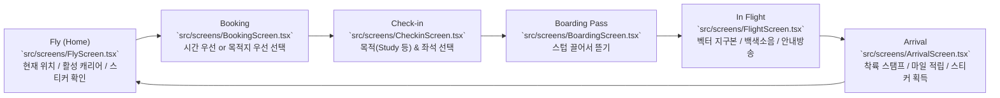

# Carry On — Corpus Map & Codebase Index

> **AI Agent Quick Directive**:
> This document is the single source of truth for repository structure, module responsibilities, symbol exports, and domain logic.
> **Before reading multiple source files, consult this map** to identify the exact 1–2 target files needed. Do NOT read entire directories into context.

---

## 1. Quick Intent Router (기능별 직행 색인)

AI 에이전트가 특정 작업 요청을 받았을 때 바로 찾아갈 파일 매핑입니다.

| 작업 목적 (Task Intent) | 핵심 파일 (Primary Files) | 연관 컴포넌트/스타일 | 테스트 파일 |
|---|---|---|---|
| **비행 시간 / 거리 계산 공식** | `src/domain/geo.ts` | `src/domain/booking.ts` | `src/domain/geo.test.ts` |
| **목적지 / 소요시간 기반 예약** | `src/domain/booking.ts`, `src/screens/BookingScreen.tsx` | `src/screens/BookingScreen.module.css`, `src/data/cities.ts` | `src/domain/booking.test.ts` |
| **비행계획 / 편명 / 게이트 생성** | `src/domain/flightPlan.ts` | `src/data/airlines.ts`, `src/domain/random.ts` | `src/domain/flight.test.ts` |
| **좌석 배치도 / 기종별 캐빈 / 자동 배정** | `src/domain/seatmap.ts` | `src/components/SeatMapView.tsx`, `src/components/SeatMapView.module.css` | `src/domain/flight.test.ts` |
| **기내 엔진 백색소음 / 합성 사운드** | `src/audio/cabinAudio.ts` | `src/audio/announcer.ts`, `src/audio/tearSound.ts` | — |
| **탑승권 스텁 뜯기 / 찢는 소리** | `src/components/BoardingPass.tsx`, `src/audio/tearSound.ts` | `src/components/BoardingPass.module.css`, `src/screens/BoardingScreen.tsx` | — |
| **기내 안내방송 텍스트 & TTS 재생** | `src/domain/announcements.ts` (확정 대본), `src/audio/announcer.ts` | `src/screens/FlightScreen.tsx` (방송 타이밍: 이륙·순항·하강·착륙·난기류), `src/screens/ArrivalScreen.tsx` | `src/domain/announcements.test.ts` |
| **비행 모니터 상태 (고도/속도/페이즈)** | `src/domain/flightProfile.ts` | `src/screens/FlightScreen.tsx`, `src/screens/FlightScreen.module.css` | `src/domain/flight.test.ts` |
| **지구본 지도 / 낮밤 음영 / 태양 위치** | `src/map/FlightMap.tsx`, `src/domain/sun.ts` | `src/map/FlightMap.module.css`, `src/map/worldData.ts` | `src/domain/sky.test.ts` |
| **착륙 처리 / 마일리지 / 스티커 발급** | `src/domain/landing.ts`, `src/db/db.ts` | `src/screens/ArrivalScreen.tsx`, `src/screens/ArrivalScreen.module.css` | `src/domain/flight.test.ts` |
| **캐리어 표시 / 스티커 데칼(2D 임시)** | `src/components/CarrierView.tsx` | `src/components/CarrierView.module.css`, `src/screens/FlyScreen.tsx` | — |
| **수하물 태그 및 스티커 디자인** | `src/components/BagTag.tsx` | `src/components/BagTag.module.css`, `src/components/Barcode.tsx` | — |
| **회원 등급 (Tier) 및 마일리지 보너스** | `src/domain/tier.ts` | `src/store/useTier.ts`, `src/components/TierBadge.tsx` | `src/domain/tier.test.ts` |
| **로컬 DB 스키마 / IndexedDB 함수** | `src/db/db.ts` | `src/store/appStore.ts` | — |
| **도시 및 공항 데이터 (IATA/좌표/시차)** | `src/data/cities.ts` | `src/domain/types.ts` | — |
| **가상 항공사 데이터 (코드/이름/리버리색)** | `src/data/airlines.ts` | `src/components/BagTag.tsx`, `src/domain/flightPlan.ts` | — |
| **화면 전환 / 내비게이션 / 드래프트 상태** | `src/store/appStore.ts`, `src/App.tsx` | `src/App.module.css`, `src/components/TabBar.tsx` | — |
| **볼륨 / 맵스타일 / 오디오 설정 (로컬저장)** | `src/store/settings.ts` | `src/screens/FlightScreen.tsx` | — |
| **글로벌 테마 / 폰트 / 다크모드 스타일** | `src/styles/global.css` | `src/App.module.css` | — |
| **개발 모드 플래그 (?tier=, ?speed=)** | `src/dev.ts` | `src/store/useTier.ts`, `src/screens/FlightScreen.tsx` | — |

---

## 2. Core Architecture & Lifecycle Flow

Carry On은 집중 타이머(Pomodoro 대안)를 항공기 여정 경험으로 치환한 웹/모바일 앱입니다.
로컬 퍼스트(Dexie IndexedDB)로 동작하며, 화면 흐름은 Flighty-style 단선형 여행 단계를 따릅니다.



### 상태 데이터 흐름
1. **Fly**: `db.profile` & `db.carriers` & `db.stickers` 조회 → 홈 화면 렌더.
2. **Booking**: 사용자가 목적지 또는 시간을 선택 → `planRoute()` or `planScenic()` 호출 → `useApp.setDraft({ plan, purpose: 'study' })`.
3. **Checkin**: 좌석 선택 (`buildSeatMap()`, `autoAssign()`) 및 목적(purpose) 확정 → `draft.seat` 저장.
4. **Boarding**: 탑승권 스텁 드래그 완료 시 `startFlight()` 실행 → IndexedDB에 `Flight` 저장 (`status: 'in_flight'`) → `cabinAudio.start()` 엔진 사운드 시작.
5. **Flight**: 실시간 타이머 및 진행률 계산 → 고도/속도 프로파일 갱신 → 도착 시 `landFlight()` 실행 (또는 포기 시 `divertFlight()`).
6. **Arrival**: 마일리지 가산, 스티커 생성 및 캐리어에 부착 완료 후 다시 `Fly` 화면으로 복귀.

---

## 3. Directory & File Manifest

### 3.1 Root & Configuration

| File | Responsibilities | Key Exports / Elements | Dependencies |
|---|---|---|---|
| `package.json` | 프로젝트 메타데이터, 의존성, 스크립트 | React 19, Vite 8, Dexie 4, d3-geo 3, Vitest 5, Zustand 5 | — |
| `vite.config.ts` | Vite 번들러 설정 | `@vitejs/plugin-react` | — |
| `tsconfig.json` | TypeScript 설정 | `target: ES2022`, `moduleResolution: bundler` | — |
| `index.html` | HTML 진입점, 모바일 뷰포트, 다크 테마 배경 | `#root`, 메타 태그, 폰트 선언 | — |
| `src/main.tsx` | React 렌더링 진입점, 폰트 CSS import | `createRoot` | `src/App.tsx`, `@fontsource/*`, `src/styles/global.css` |
| `src/App.tsx` | 최상위 화면 라우팅, 초기 프로필 로드, 미완료 비행 복구 | `App()`, `TAB_SCREENS` | `src/store/appStore.ts`, `src/db/db.ts`, `src/App.module.css` |
| `src/App.module.css` | 앱 뷰포트 컨테이너 레이아웃 (모바일 화면 프레임, 안전영역) | `.app`, `.main` | — |
| `src/dev.ts` | 개발용 URL 파라미터 제어 (`?tier=`, `?speed=`) | `DEV_TIER`, `TIME_SCALE` | `src/domain/types.ts` |
| `src/styles/global.css` | 글로벌 CSS 리셋, 테마 토큰, 등급별 색상 변수(`data-tier`), 폰트 패밀리 정의 | `--bg`, `--text`, `--tier-silver/gold/platinum`, `.label`, `.mono` | `@fontsource/*` |

---

### 3.2 Database & Stores (`src/db/`, `src/store/`)

| File | Responsibilities | Key Exports | Consumers |
|---|---|---|---|
| `src/db/db.ts` | Dexie(IndexedDB) 스키마 정의 및 트랜잭션 함수 | `db`, `loadOrCreateProfile()`, `startFlight()`, `getActiveFlight()`, `landFlight()`, `divertFlight()`, `countStickers()`, `Profile`, `Carrier`, `Flight`, `Sticker` | `src/App.tsx`, `src/screens/*` |
| `src/store/appStore.ts` | UI 전역 화면 전환 및 비행 드래프트/결과 관리 | `useApp`, `Screen`, `Draft`, `AppState` | 모든 화면 및 컴포넌트 |
| `src/store/settings.ts` | 사용자 기기별 로컬 스토리지 환경설정 | `useSettings`, `MapStyle` (`'paper'`, `'classic'`, `'dark'`), 볼륨/차임/방송 토글 | `src/screens/FlightScreen.tsx`, `src/screens/ArrivalScreen.tsx` |
| `src/store/useTier.ts` | 현재 사용자 회원 등급 리액티브 훅 (`DEV_TIER` 우선 반영) | `useTier()`: `Tier` | `src/App.tsx`, `src/components/*`, `src/screens/*` |

---

### 3.3 Domain Logic (`src/domain/`)

*순수 함수 중심의 비즈니스 로직으로, 단위 테스트(`*.test.ts`)와 1:1 대응합니다.*

| File | Responsibilities & Formula | Key Exports | Related Test |
|---|---|---|---|
| `src/domain/types.ts` | 지리 좌표, 도시, 회원 등급, 기종 클래스 공통 인터페이스 | `LatLon`, `City`, `Tier`, `AircraftClass`, `Route` | All domain |
| `src/domain/geo.ts` | 대권거리(Haversine), 비행시간(km/800*60+30), 마일(km*0.621), 기종 분류 | `distanceKm()`, `flightMinutes()`, `milesFor()`, `aircraftFor()`, `formatDuration()` | `src/domain/geo.test.ts` |
| `src/domain/booking.ts` | 도시 간 노선 계산, 비행시간 근접 도시 검색 (±10% 허용오차), 관광비행 마일 | `routeBetween()`, `routesFrom()`, `routesNearDuration()`, `scenicMiles()`, `SCENIC_MAX_MINUTES` | `src/domain/booking.test.ts` |
| `src/domain/flightPlan.ts` | 탑승권에 찍힐 확정 비행계획(노선, 가상항공사, 편명, 게이트) 빌드 | `planRoute()`, `planScenic()`, `FlightPlan`, `AIRCRAFT_LABEL` | `src/domain/flight.test.ts` |
| `src/domain/flightProfile.ts` | 실시간 비행 상태(상승/순항/하강 페이즈, 고도ft, 대지속도km/h, 외기온도℃) 산출 | `flightState()`, `phaseBounds()`, `FlightPhase`, `FlightState` | `src/domain/flight.test.ts` |
| `src/domain/landing.ts` | 착륙 시 획득 마일리지(등급 보너스 반영), 수하물 태그 종류 결정, 진행률/남은시간 계산 | `earnedMiles()`, `stickersForLanding()`, `remainingMs()`, `progress()`, `formatClock()` | `src/domain/flight.test.ts` |
| `src/domain/seatmap.ts` | 기종별(A320/787/A350) 좌석배치도 생성, 난수 점유 좌석 생성, 등급별 해금, 자동 배정 | `buildSeatMap()`, `autoAssign()`, `canPick()`, `cabinUnlocked()`, `Seat`, `SeatMap`, `CabinClass`, `SeatZone` | `src/domain/flight.test.ts` |
| `src/domain/announcements.ts` | **확정 대본** (SPEC §3.8). 방송별 화자(captain/crew)·차임·문구, 관광비행 변형, 시각/고도/편명 낭독 규칙 | `welcome()`, `takeoff()`, `cruise()`, `descent()`, `landing()`, `arrival()`, `breakStart()`, `seatbelt()`, `spokenDuration()`, `spokenAbout()`, `spokenFlightNumber()`, `spokenAltitude()`, `spokenTime()`, `partOfDay()`, `Announcement`, `Speaker`, `Chime` | `src/domain/announcements.test.ts` |
| `src/domain/sun.ts` | 저정밀 태양 천문력 기반 태양 직하점(subsolar point) 계산 및 주야간 경계(isNight) 판별 | `subsolarPoint()`, `centralAngle()`, `isNight()` | `src/domain/sky.test.ts` |
| `src/domain/tier.ts` | 누적 마일에 따른 회원 등급(Basic, Silver, Gold, Platinum) 및 다음 등급 잔여 마일 계산 | `tierFor()`, `nextTier()`, `tierLabel()`, `TIER_THRESHOLDS`, `TIER_MILE_BONUS` | `src/domain/tier.test.ts` |
| `src/domain/random.ts` | 문자열 결정론적 시드 해시(djb2) 및 시드 의사난수 생성기(LCG) | `hashString()`, `seededRandom()` | `src/domain/flight.test.ts` |
| `src/domain/time.ts` | 특정 IANA 타임존의 현지 시각 문자열("HH:MM") 및 시/분 숫자 | `localTime()`, `localHourMinute()` | `src/domain/time.test.ts` |

---

### 3.4 Audio (`src/audio/`)

*외부 오디오 파일 없이 Web Audio API를 활용해 순수 코드로 백색소음 및 효과음을 실시간 합성합니다.*

| File | Responsibilities | Key Exports | Characteristics |
|---|---|---|---|
| `src/audio/cabinAudio.ts` | 정통 브라운 노이즈(1/f² 적분기 동체 럼블) + 핑크 노이즈(1/f HVAC 공조음) + 제트 터빈 험 & 비행 목적별 은닉 뇌파 바이노럴 비트(SMR 14Hz / Alpha 10Hz / Gamma 40Hz) 실시간 합성, 좌석/페이즈별 믹싱, 차임음 | `cabinAudio` (싱글톤 인스턴스) | AudioContext 언락, Master DynamicsCompressor 내장, 무한 루프 무결점 합성 |
| `src/audio/tearSound.ts` | 탑승권 스텁을 찢을 때 종이 섬유가 뜯어지는 미세 파열음(Grains) 동적 합성 | `tearSound.advance(delta)`, `tearSound.snap()` | 제스처 드래그 속도에 비례한 그레인 밀도 |
| `src/audio/announcer.ts` | Web Speech API 기반 임시 안내방송. 화자별 기기 음성 선택(기장=남성 Ryan/Guy/Daniel…, 승무원=여성 Sonia/Aria/Samantha…), 방송별 차임(2음/1음) 후 송출, 큐잉 | `announce(announcement)`, `silenceAnnouncements()` | Kokoro 사전 생성 클립으로 교체 예정 (SPEC §3.8) |

---

### 3.5 Map & Visualization (`src/map/`)

| File | Responsibilities | Key Exports | Tech Stack |
|---|---|---|---|
| `src/map/FlightMap.tsx` | 대권항로 곡선, 실시간 비행기 위치/헤딩, 낮/밤 터미네이터 음영, 도시 불빛 렌더링 SVG 지도 | `FlightMap` | `d3-geo` (`geoOrthographic`, `geoInterpolate`, `geoPath`) |
| `src/map/FlightMap.module.css` | 지도 뷰어 스타일, 페이퍼/클래식/다크 맵 테마별 SVG 스타일링 | `.map[data-style="paper"]`, `.nightMesh`, `.flownPath` | — |
| `src/map/worldData.ts` | Natural Earth 1:50m 벡터 국경 데이터 지연 로딩(Lazy load) 및 캐싱 | `loadWorld()`, `WorldData` | `world-atlas`, `topojson-client` |

---

### 3.6 Screens (`src/screens/`)

| Screen File | Style File | Route Name | Responsibilities |
|---|---|---|---|
| `src/screens/FlyScreen.tsx` | `src/screens/FlyScreen.module.css` | `'fly'` | 홈 화면. 현재 체류 공항, 현지 시각 인사말, 캐리어 상태, 마일리지/등급, 'Book flight' CTA |
| `src/screens/BookingScreen.tsx` | `src/screens/BookingScreen.module.css` | `'booking'` | 출발지 선택, 집중 시간 기준(By focus time) 또는 목적지 기준(By destination) 노선 탐색 및 관광비행 선택 |
| `src/screens/CheckinScreen.tsx` | `src/screens/CheckinScreen.module.css` | `'checkin'` | 비행 목적(Study, Work 등) 선택, 좌석 배치도에서 좌석 선택 또는 'Assign for me' 자동 배정 |
| `src/screens/BoardingScreen.tsx` | `src/screens/BoardingScreen.module.css` | `'boarding'` | 탑승 대기 화면. 찢을 수 있는 탑승권(`BoardingPass`) 렌더 및 제스처 시 오디오 언락 |
| `src/screens/FlightScreen.tsx` | `src/screens/FlightScreen.module.css` | `'flight'` | 비행 중 화면. 벡터 지구본 지도, 기내 모니터 정보(고도/속도/남은시간), 백색소음 재생, 페이즈별 방송 |
| `src/screens/ArrivalScreen.tsx` | `src/screens/ArrivalScreen.module.css` | `'arrival'` | 착륙 화면. 환영 방송, 입국 도장, 획득 마일리지 표시, 획득한 수하물 태그/스티커 부착 연출 |
| `src/screens/PlaceholderScreen.tsx` | `src/screens/PlaceholderScreen.module.css` | `'luggage'`, `'dutyfree'`, `'passport'` | Phase 2 구현 예정 기능들을 위한 안내 플레이스홀더 화면 |

---

### 3.7 UI Components (`src/components/`)

| Component | Component File | Style File | Responsibilities |
|---|---|---|---|
| `BoardingPass` | `src/components/BoardingPass.tsx` | `src/components/BoardingPass.module.css` | 실제 항공권 스타일 탑승권. 스텁 드래그/클릭으로 뜯기 인터랙션, 바코드, 승객 정보, 등급별 색상 테두리 |
| `SeatMapView` | `src/components/SeatMapView.tsx` | `src/components/SeatMapView.module.css` | 항공기 단면 좌석도 뷰. First/Business/Economy 구역, 통로, 날개 위치, 비상구 및 범례(`SeatLegend`) 표시 |
| `CarrierView` | `src/components/CarrierView.tsx` | `src/components/CarrierView.module.css` | 2D 캐리어 외형 SVG 및 획득한 스티커 배치/에이징 연출 (Phase 2에서 3D Three.js로 교체 예정) |
| `BagTag` | `src/components/BagTag.tsx` | `src/components/BagTag.module.css` | 실제 감열지 수하물 태그 스타일 렌더 (도착지 IATA 코드, 바코드, 가상 항공사 색상 띠, 일련번호) |
| `TicketButton` | `src/components/TicketButton.tsx` | `src/components/TicketButton.module.css` | 천공선과 스텁 화살표가 있는 항공권 모티브의 메인 액션 버튼 |
| `Barcode` | `src/components/Barcode.tsx` | — (SVG 인라인) | 순수 SVG 기반 결정론적 바코드 렌더러 |
| `StageBar` | `src/components/StageBar.tsx` | `src/components/StageBar.module.css` | 체크인 → 탑승 → 비행 → 도착 단계를 보여주는 진행 상태 바 |
| `TabBar` | `src/components/TabBar.tsx` | `src/components/TabBar.module.css` | 하단 탭 내비게이션 (Fly, Luggage, Duty Free, Passport) |
| `TierBadge` | `src/components/TierBadge.tsx` | `src/components/TierBadge.module.css` | Silver, Gold, Platinum 회원 등급 배지 |
| `MilesStamp` | `src/components/MilesStamp.tsx` | `src/components/MilesStamp.module.css` | 보유 마일리지 잔액 뱃지 |
| `ScreenHeader` | `src/components/ScreenHeader.tsx` | `src/components/ScreenHeader.module.css` | 뒤로가기 버튼과 타이틀/서브타이틀이 포함된 화면 헤더 |
| `Icon` | `src/components/Icon.tsx` | — (SVG 인라인) | 경량 인라인 SVG 아이콘 세트 (plane, ticket, suitcase, globe, volume 등) |

---

### 3.8 Static & Master Data (`src/data/`)

| File | Content & Rules |
|---|---|
| `src/data/cities.ts` | 65개 주요 공항 좌표(WGS84), IATA 코드, 공항명, 국가, IANA 타임존 (출처: OurAirports 공공도메인). 기본 출발지: `ICN` |
| `src/data/airlines.ts` | 상표권 문제를 회피하기 위한 국가별 12개 가상 항공사 (예: Hanul Air `HL`, Sakura Wings `SW`, Carry On Airways `CO` 등) 및 리버리 색상 |

---

### 3.9 Documentation (`docs/`)

| Document | Purpose |
|---|---|
| `docs/SPEC.md` | 전체 기능 기획 설계서 v1.0 (핵심 루프, 비행 시스템, 사운드, 스티커, 캐리어 3D 계획, 경제/마일리지 시스템, 로드맵) |
| `docs/ASSETS.md` | 오픈소스 폰트, 데이터셋, 에셋 라이선스 및 출처 기록부 |

---

## 4. Key Domain Rules & Numeric Standards

AI 에이전트가 코드를 수정할 때 반드시 준수해야 하는 기준값입니다.

1. **비행 시간 공식 (`src/domain/geo.ts`)**:
   $$\text{flightMinutes} = \text{round}_5\left( \frac{\text{km}}{800} \times 60 + 30 \right)$$
   - 순항속도 $800\text{ km/h}$, 지상 유도로/이착륙 시간 기본 $+30\text{분}$, 최종 5분 단위 반올림.
2. **관광 비행 (Scenic Flight) (`src/domain/booking.ts`)**:
   - 최대 45분 이하, 출발 공항 반경 약 40km 선회 비행, 마일리지 = $\text{분} \times 5\text{ 마일}$.
3. **회원 등급 및 마일리지 보너스 (`src/domain/tier.ts`)**:
   - `basic`: 0 mi (+0%)
   - `silver`: 10,000 mi (+0%, Business석 해금)
   - `gold`: 50,000 mi (+10% 마일리지 보너스)
   - `platinum`: 150,000 mi (+25% 마일리지 보너스, First석 해금)
4. **엄격 모드 (Strict Mode) 사양 (`docs/SPEC.md §3.9`)**:
   - 모바일: 백그라운드 이탈 시 1분 유예 후 '회항(Diverted)' 처리 (보상 0 mi).
   - 데스크톱: 창 전환은 허용, 명시적 앱 종료/비행 포기만 회항 처리.

---

## 5. Map Maintenance Guide (맵 수정 및 동기화)

코드베이스의 파일이나 심볼이 변경되었을 때 이 맵을 최신 상태로 유지하는 방법:

1. **새로운 도메인 로직이나 컴포넌트 추가 시**:
   - 본 `CORPUS_MAP.md`의 **Section 1 (Quick Intent Router)**과 **Section 3 (Directory & File Manifest)**에 해당 파일 행을 추가합니다.
2. **자동 동기화 검증 스크립트 실행**:
   - 프로젝트 루트에서 아래 명령어를 실행하면 실제 파일 시스템과 맵의 정합성을 검사하고 미등록 파일을 알려줍니다:
     ```bash
     npm run map
     # 또는
     npm run map:verify
     ```
   - 스크립트 파일: `scripts/sync-corpus-map.mjs`
