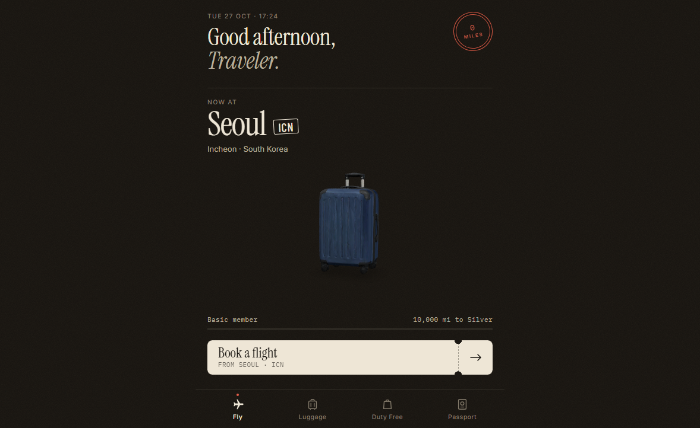
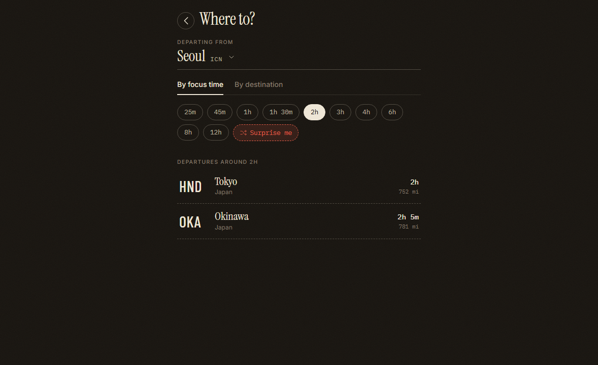
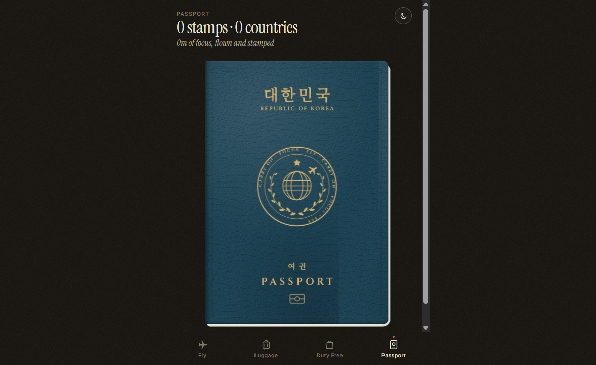
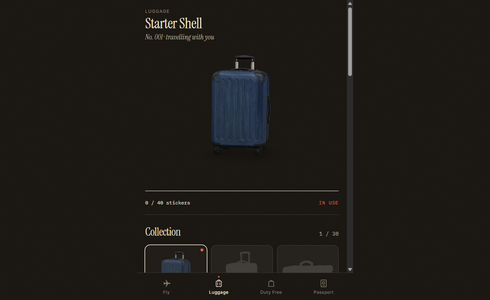
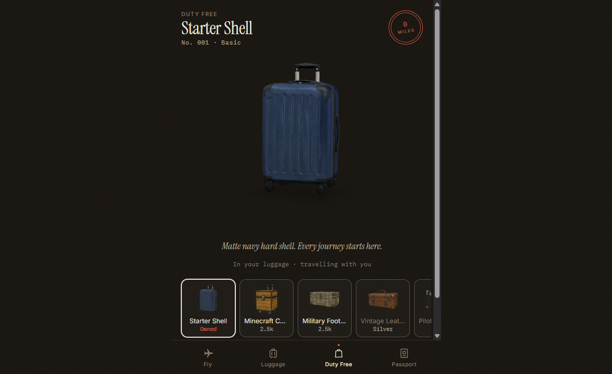

<div align="center">

  

  # Carry On
  
  **Focus as a Journey, Miles into Baggage.**  
  *Transform your focus sessions into authentic airline flights.*

  <br />

  <!-- Release / Download Badges -->
  <a href="https://github.com/HANSEIDON/Carry-On/releases/latest">
    
  </a>
  <a href="#-platform--release-status">
    
  </a>

  <br /><br />

  <!-- Main Hero: Real App Home Screen -->
  

</div>

<br />

---

## 🛫 Overview

**Carry On** replaces tedious countdown timers with the calming immersion of commercial aviation.

Instead of staring at a ticking clock, you book a flight based on authentic flight times, select your seat, and tear off the boarding pass stub to start focusing. During cruise, you focus within an acoustic cabin soundscape modeled from real in-flight recordings (A320, B737, B777). Once you land, you earn miles, collect destination stickers on a 3D suitcase, and receive stamped visas in your passport.

---

## 🪟 Platform & Release Status

| Platform | Status | Distribution |
|:---|:---:|:---|
| **Windows Desktop** | **Available** | **[Download Latest .exe (v0.1.0)](https://github.com/HANSEIDON/Carry-On/releases/latest)** |
| **Android** | *In Development* | Planned via Capacitor / APK & Play Store |
| **iOS** | *In Roadmap* | Planned via Capacitor / TestFlight |
| **Web (Local)** | **Available** | Run locally via `npm run dev` or `dev.bat` |

---

## 📸 App Experience & Real Screenshots

### 1. Home & 3D Suitcase (`Fly`)
Your journey starts from where your last flight landed. The turning 3D suitcase displays your collected destination stickers, tier progress, and current mileage balance.

<div align="center">
  
</div>

<br />

### 2. Destination & Duration Booking (`Booking`)
Choose how long you want to focus (25m to 12h) to see matching global destinations, or search for any city with authentic great-circle flight times. Scenic flights are available for shorter 30–45m sessions.

<div align="center">
  
</div>

<br />

### 3. ICAO 9303 Digital Passport (`Passport`)
Your personal flight record formatted as an international standard passport, complete with official 2×44 Machine Readable Zones (MRZ), immigration entry/exit stamps, and total distance traveled.

<div align="center">
  
</div>

<br />

### 4. 3D Luggage Room & Duty Free (`Luggage & Shop`)
Inspect your suitcase collection in 3D, organize destination stickers, and spend accumulated miles in the Duty Free shop on over 30 distinct carrier models.

<div align="center">
  
  &nbsp;
  
</div>

---

## 🔬 Scientific Foundation: Low-Frequency Noise & Focus Mode

Extended exposure to commercial aircraft rumble induces subtle cognitive strain and fatigue. Carry On incorporates environmental psychoacoustics based on clinical research by Persson Waye et al.

<div align="center">
  
</div>

* **Elevated Cortisol Levels**: Research demonstrates that 40 dBA low-frequency ventilation noise inhibits natural circadian cortisol reduction in noise-sensitive individuals, keeping stress elevated during cognitive work (*Persson Waye et al., Life Sciences, 2002*).
* **Demanding Task Performance**: Heavy low-frequency hum significantly degrades performance quality and accuracy in complex focus tasks (*Persson Waye et al., Journal of Sound and Vibration, 1997*).

<div align="center">
  
</div>

* **Carry On Focus Mode**: Applies a gentle **-7.0 dB low-shelf filter** below 160 Hz to strip away exhausting sub-bass rumble while keeping 100% of the speech-masking airflow (> 320 Hz) intact.

---

## 🚀 Quick Start (Developers)

```bash
# Clone and install
git clone https://github.com/HANSEIDON/Carry-On.git
cd Carry-On
npm install

# Run web app locally (Auto-opens browser)
npm run dev

# Or double-click dev.bat on Windows
```

### Packaging Windows .exe (Electron)

```bash
# Build standalone Windows installer & portable executable
npm run electron:build
```
> Executable output will be placed in the `release/` folder.

---

## 📄 References & Standards

* **Low frequency noise enhances cortisol among noise sensitive subjects during work performance**  
  Persson Waye et al., *Life Sciences*, 2002. [Google Scholar](https://scholar.google.com/scholar?q=Low+frequency+noise+enhances+cortisol+among+noise+sensitive+subjects+during+work+performance)
* **Effects on performance and work quality due to low frequency ventilation noise**  
  Persson Waye et al., *Journal of Sound and Vibration*, 1997. [Google Scholar](https://scholar.google.com/scholar?q=Effects+on+performance+and+work+quality+due+to+low+frequency+ventilation+noise)
* **ITU-R BS.1770-4**: *Loudness and true-peak audio measurement standard*, International Telecommunication Union. [ITU](https://www.itu.int/rec/R-REC-BS.1770)
