<div align="center">

  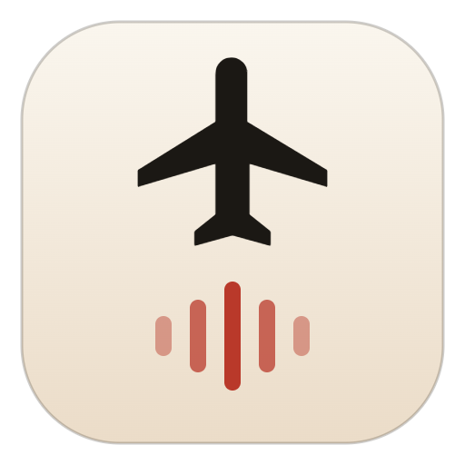

  # Carry On
  
  **Turn on your Flight Mode.**  
  *Transform your focus sessions into authentic airline flights.*

  <br />

  <!-- Boarding Pass Ticket CTA (GitHub Dark / Light Adaptive) -->
  <a href="https://github.com/HANSEIDON/Carry-On/releases/tag/v0.1.0">
    <picture>
      <source media="(prefers-color-scheme: dark)" srcset="assets/download-ticket-dark.png">
      <source media="(prefers-color-scheme: light)" srcset="assets/download-ticket-light.png">
      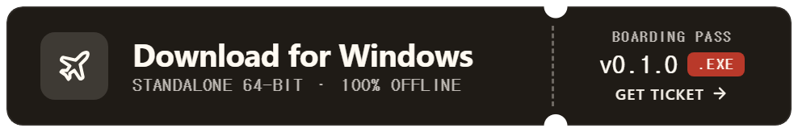
    </picture>
  </a>

  <br /><br />

  <!-- Hero 3D Composite Showcase -->
  <p align="center">
    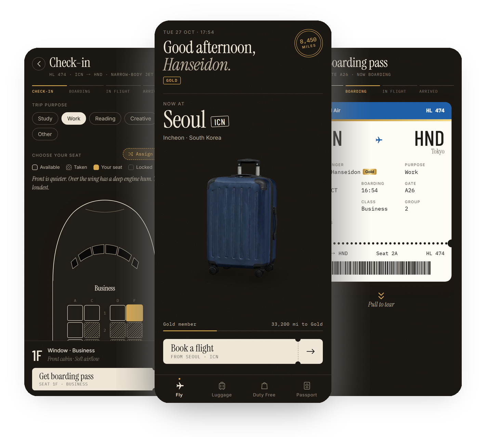
  </p>

</div>

<br />

---

<span id="overview"></span>

## 🛫 Overview

**Carry On** replaces tedious countdown timers with the calming immersion of commercial aviation.

Instead of staring at a ticking clock, you book a flight based on authentic flight times, select your seat, and tear off the boarding pass stub to start focusing. During cruise, you focus within an acoustic cabin soundscape modeled from real in-flight recordings (A320, B737, B777). Once you land, you earn miles, collect destination stickers on a 3D suitcase, and receive stamped visas in your passport.

---

<span id="download"></span>

## 📥 Download & Installation

Carry On is **100% offline and standalone**. All flight logs, mileage balances, and earned luggage stickers are securely stored on your local device with zero server requirements.

### 🪟 Windows Desktop (Available Now)

Standalone 64-bit Windows executables (`v0.1.0`):

| Package | Download Link | Size | Type | Installation & Usage |
|:---|:---|:---:|:---:|:---|
| **Portable** | [**`Carry-On-0.1.0-Portable.exe`**](https://github.com/HANSEIDON/Carry-On/releases/download/v0.1.0/Carry-On-0.1.0-Portable.exe) | 365 MB | `.exe` | **Zero install needed.** Double-click to launch immediately from USB or any local folder. |
| **Setup Installer** | [**`Carry-On-Setup-0.1.0.exe`**](https://github.com/HANSEIDON/Carry-On/releases/download/v0.1.0/Carry-On-Setup-0.1.0.exe) | 387 MB | `.exe` | Standard Windows setup with desktop shortcut and Start Menu integration. |

> 💡 All release packages are published under **[GitHub Releases (v0.1.0)](https://github.com/HANSEIDON/Carry-On/releases/tag/v0.1.0)**. Developers can also compile locally via `npm run electron:build` (output in `release/`).

---

### 📱 Android (In Development)

* Standalone `.apk` package and Google Play Store (`.aab`) bundle are actively being configured via Capacitor.
* Retains the identical zero-server local storage and soundscape engine.

---

<span id="platform-status"></span>

## 🪟 Platform & Release Status

| Platform | Status | Distribution & Storage |
|:---|:---:|:---|
| **Windows Desktop** | **Local / Packageable** | 100% Offline Standalone (.exe) · Local IndexedDB Storage |
| **Android** | *In Development* | Planned via Capacitor / APK & Play Store |
| **iOS** | *In Roadmap* | Planned via Capacitor / TestFlight |
| **Web (Local)** | **Available** | Run locally via `npm run dev` or `dev.bat` |

---

<span id="showcase"></span>

## 📱 Flight Journey Showcase

### 1. Home & 3D Interactive Suitcase (`Fly`)
Your journey starts from where your last flight landed. A pristine 3D suitcase stands ready for departure, displaying your departure city, local time, membership tier, and current mileage balance.

<div align="center">
  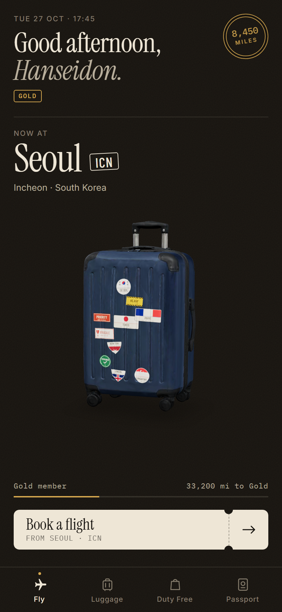
</div>

<br />

### 2. Great-Circle Flight Booking (`Booking`)
Choose how long you want to focus (25m to 12h) to see matching global destinations, or search for any city with authentic great-circle flight times. Scenic flights are available for shorter 30–45m sessions.

<div align="center">
  
</div>

<br />

### 3. Authentic Airplane Seat Map (`Check-in`)
Select your seat directly on the aircraft cabin layout—First, Business, or Economy. Choose between window and aisle positions, with seat locations dynamically tuning the in-flight soundscape.

<div align="center">
  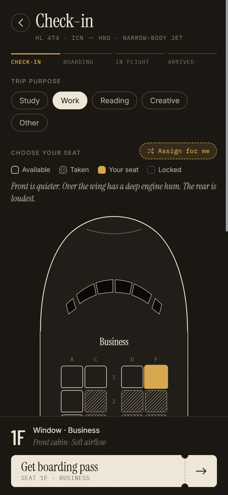
</div>

<br />

### 4. Boarding Pass with Tearable Stub (`Boarding`)
A realistically typeset airline ticket featuring departure/arrival IATA codes, passenger name, seat assignment, gate, and barcode. Dragging and tearing the perforated stub triggers the takeoff sequence.

<div align="center">
  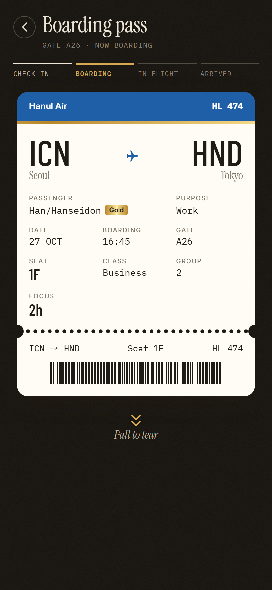
</div>

<br />

### 5. Digital Passport & Visa Stamps (`Passport`)
Your personal flight log formatted as an international standard passport (ICAO 9303 TD3 MRZ). Every completed flight stamps your visa pages with country-accurate date formats and custom ink colors.

<div align="center">
  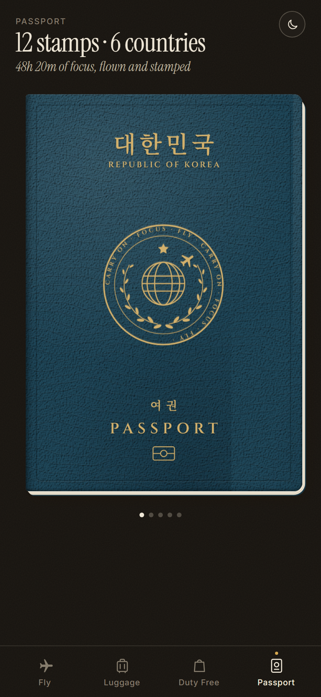
</div>

<br />

### 6. Luggage Room & Sticker Collection (`Luggage`)
Inspect your collection of travel cases on the luggage shelf in real-time 3D. Rotate suitcases, view all earned destination stickers, and switch your active travel bag.

<div align="center">
  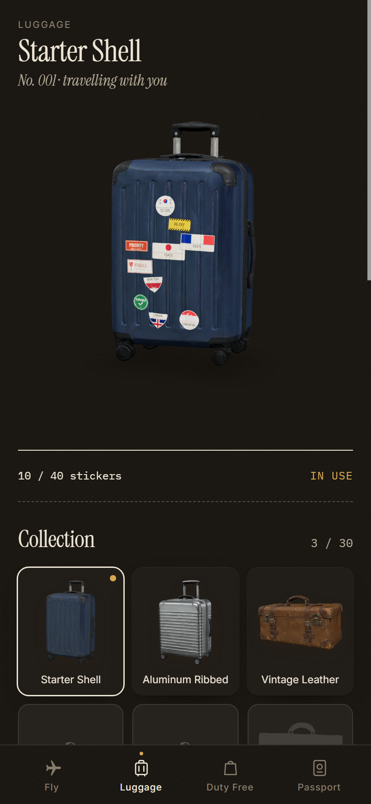
</div>

<br />

### 7. Carrier Catalog & Duty Free Shop (`Duty Free`)
A dictionary catalog of over 30 distinct luggage models across membership tiers. Spend accumulated flight miles in the Duty Free boutique to collect new carrier designs.

<div align="center">
  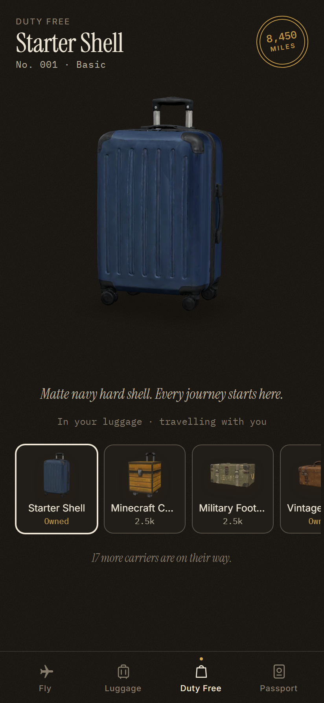
</div>

---

<span id="acoustics"></span>

## 🔬 Scientific Foundation: Low-Frequency Noise & Focus Mode

Extended exposure to commercial aircraft rumble induces subtle cognitive strain and fatigue. Carry On incorporates environmental psychoacoustics based on clinical research by Persson Waye et al.

<div align="center">
  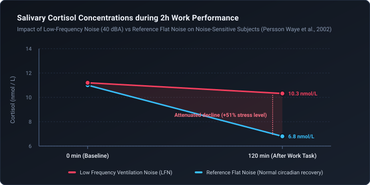
</div>

* **Elevated Cortisol Levels**: Research demonstrates that 40 dBA low-frequency ventilation noise inhibits natural circadian cortisol reduction in noise-sensitive individuals, keeping stress elevated during cognitive work (*Persson Waye et al., Life Sciences, 2002*).
* **Demanding Task Performance**: Heavy low-frequency hum significantly degrades performance quality and accuracy in complex focus tasks (*Persson Waye et al., Journal of Sound and Vibration, 1997*).

<div align="center">
  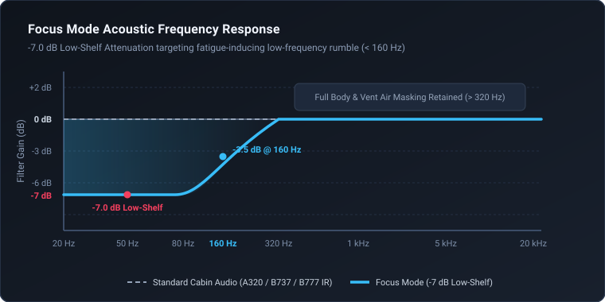
</div>

* **Carry On Focus Mode**: Applies a gentle **-7.0 dB low-shelf filter** below 160 Hz to strip away exhausting sub-bass rumble while keeping 100% of the speech-masking airflow (> 320 Hz) intact.

---

## 🚀 Quick Start (Developers)

```bash
# Clone and install
git clone https://github.com/HANSEIDON/Carry-On.git
cd Carry-On
npm install

# Run web app locally (Auto-opens browser)
npm run dev

# Or double-click dev.bat on Windows
```

### Packaging Windows .exe (Electron)

```bash
# Build standalone Windows installer & portable executable
npm run electron:build
```
> Executable output will be placed in the `release/` folder.

---

## 📄 References & Standards

* **Low frequency noise enhances cortisol among noise sensitive subjects during work performance**  
  Persson Waye et al., *Life Sciences*, 2002. [Google Scholar](https://scholar.google.com/scholar?q=Low+frequency+noise+enhances+cortisol+among+noise+sensitive+subjects+during+work+performance)
* **Effects on performance and work quality due to low frequency ventilation noise**  
  Persson Waye et al., *Journal of Sound and Vibration*, 1997. [Google Scholar](https://scholar.google.com/scholar?q=Effects+on+performance+and+work+quality+due+to+low+frequency+ventilation+noise)
* **ITU-R BS.1770-4**: *Loudness and true-peak audio measurement standard*, International Telecommunication Union. [ITU](https://www.itu.int/rec/R-REC-BS.1770)
