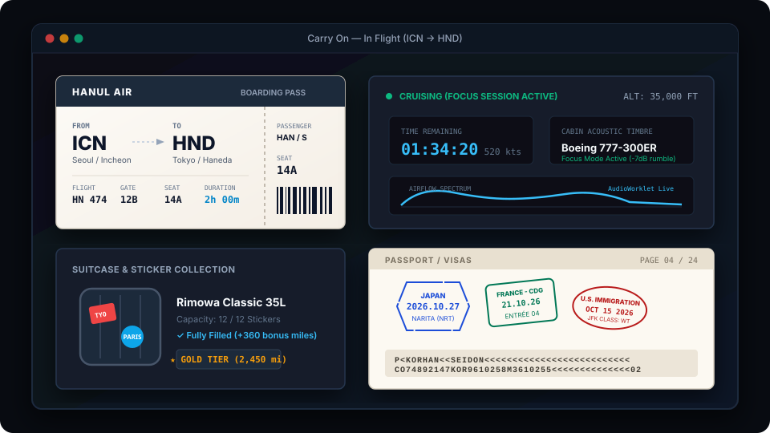

<div align="center">

  

  # Carry On
  
  **Focus as a Journey, Miles into Baggage.**  
  *Transform your focus sessions into authentic airline flights.*

  <br />

  <!-- Release / Download Badges -->
  <a href="https://github.com/HANSEIDON/Carry-On/releases/latest">
    
  </a>
  <a href="#platform-status">
    
  </a>

  <br /><br />

  <!-- Main Hero UI Showcase -->
  

</div>

<br />

---

## 🛫 Overview

**Carry On** replaces tedious countdown timers with the romantic immersion of commercial aviation.

Instead of watching a generic timer tick down, you book a flight based on authentic flight times, select your cabin seat, and tear off the perforated boarding pass stub to start working. During cruise, you focus surrounded by real-time synthesized cabin noise modeled after actual Boeing and Airbus flight recordings. Once you land, you earn miles, collect custom destination stickers on a 3D suitcase, and receive stamped visas in your passport.

---

## 🪟 Platform & Release Status

| Platform | Status | Download / Distribution |
|:---|:---:|:---|
| **Windows Desktop** | **Available** | **[Download Latest .exe (v0.1.0)](https://github.com/HANSEIDON/Carry-On/releases/latest)** |
| **Android** | *In Development* | Planned via Capacitor / APK & Play Store |
| **iOS** | *In Roadmap* | Planned via Capacitor / TestFlight |
| **Web (Local)** | **Available** | Run locally via `npm run dev` or `dev.bat` |

---

## ✈️ Visual Journey & Key Features

### 1. Boarding Pass & Great-Circle Timer
* **Great-Circle Equations**: Flight durations reflect real-world routes (e.g., Seoul to Tokyo in 2h, Paris in 12h) or short 30–45m circular "Scenic Flights".
* **Tearable Stub Interaction**: Drag and tear the perforated ticket stub with realistic haptic and sound effects to begin your focus block.

### 2. Live In-Flight Soundscape & Focus Mode
* **Real-Time Sound Synthesis (`AudioWorklet`)**: Zero audio loop seams. Dynamically generates cabin airflow body and vent air.
* **Aircraft Timbres**: Real in-flight acoustic impulse responses measured from **Airbus A320**, **Boeing 737**, and **Boeing 777-300ER**.
* **Aerodynamic Seat Zones**: Choose Front (bright, quiet), Wings (engine hum), or Rear (deep acoustic rumble).
* **In-Flight PA Announcements**: Captain and crew announcements automatically balanced with **ITU-R BS.1770** loudness standards.

### 3. 3D Luggage & Collectible Decals
* **Interactive 3D Suitcases**: Explore and customize 30 distinctive luggage models rendered in Three.js.
* **Travel Stickers**: Every completed flight rewards an authentic graphic sticker applied as a decal to your luggage.
* **Duty Free Shop**: Spend accumulated flight miles to unlock premium luggage cases and collectibles.

### 4. ICAO 9303 Digital Passport
* **International Standards**: Features official TD3 machine-readable zones (MRZ 2×44) and passport holder credentials.
* **Customs Entry Stamps**: Visas stamped upon arrival with country-accurate date notations, ink colors, and immigration borders.

---

## 🔬 Scientific Foundation: Low-Frequency Noise & Focus Mode

Extended exposure to commercial aircraft rumble induces subtle cognitive strain and fatigue. Carry On incorporates environmental psychoacoustics based on clinical research by Persson Waye et al.

<div align="center">
  
</div>

* **Elevated Cortisol Levels**: Research demonstrates that 40 dBA low-frequency ventilation noise inhibits natural circadian cortisol reduction in noise-sensitive individuals, keeping stress elevated during cognitive work (*Persson Waye et al., Life Sciences, 2002*).
* **Demanding Task Performance**: Heavy low-frequency hum significantly degrades performance quality and accuracy in complex focus tasks (*Persson Waye et al., Journal of Sound and Vibration, 1997*).

<div align="center">
  
</div>

* **Carry On Focus Mode**: Applies a gentle **-7.0 dB low-shelf filter** below 160 Hz to strip away exhausting sub-bass rumble while keeping 100% of the speech-masking airflow (> 320 Hz) intact.

---

## 🚀 Quick Start (Developers)

```bash
# Clone and install
git clone https://github.com/HANSEIDON/Carry-On.git
cd Carry-On
npm install

# Run web app locally (Auto-opens browser)
npm run dev

# Or double-click dev.bat on Windows
```

### Packaging Windows .exe (Electron)

```bash
# Build standalone Windows installer & portable executable
npm run electron:build
```
> Executable output will be placed in the `release/` folder.

---

## 📄 References & Standards

* **Low frequency noise enhances cortisol among noise sensitive subjects during work performance**  
  Persson Waye et al., *Life Sciences*, 2002. [Google Scholar](https://scholar.google.com/scholar?q=Low+frequency+noise+enhances+cortisol+among+noise+sensitive+subjects+during+work+performance)
* **Effects on performance and work quality due to low frequency ventilation noise**  
  Persson Waye et al., *Journal of Sound and Vibration*, 1997. [Google Scholar](https://scholar.google.com/scholar?q=Effects+on+performance+and+work+quality+due+to+low+frequency+ventilation+noise)
* **ITU-R BS.1770-4**: *Loudness and true-peak audio measurement standard*, International Telecommunication Union. [ITU](https://www.itu.int/rec/R-REC-BS.1770)
